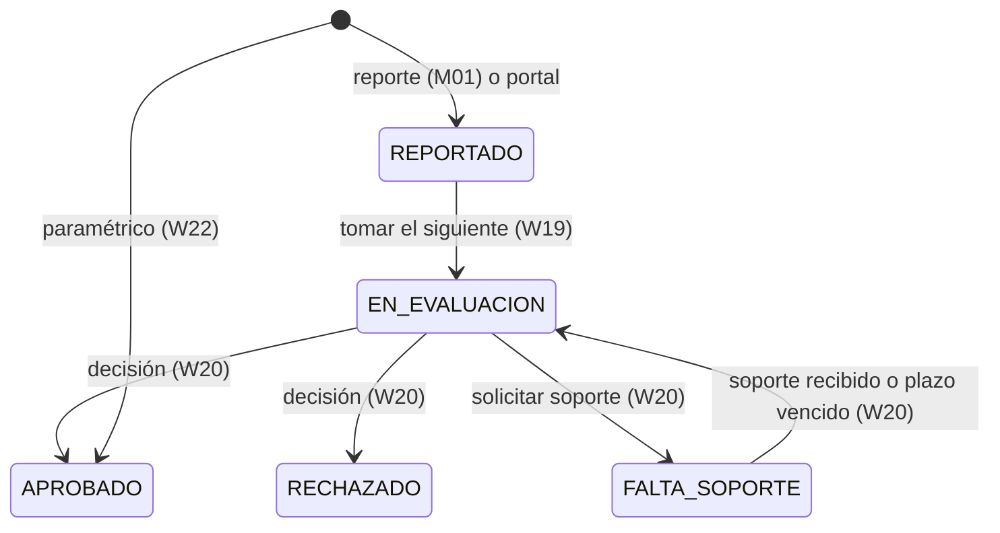

# HU-W19: evidencias de un caso (servicio `siniestros`)

Documento de la historia [HU-W19](https://github.com/sjfuentes-uniandes/proyecto-final/issues/61) (Sprint 3, recorrido R7). Es la evidencia de contrato que pide el issue: el modelo, los estados, el reloj del compromiso y el esquema de las tablas. Decisiones de diseño: DS3-01 a DS3-11 y DS3-14 del plan maestro del Sprint 3.

Estado por fase: **B1 (contratos y documentación)** ✅ · **B2 (servicio y dominio)** ✅ · B3 (aplicación, S3 y HTTP) · B4 (`bff-web`, semilla y guía, §8) · F1–F3 (portal) · C (cierre).

## 1. Qué entrega la historia

El servicio `siniestros` nace con su agregado `Siniestro`, y W19 define el esquema que usan todas las demás historias del servicio (W20, W22, W23 y M01 a M05 de otro integrante):

- **Bandeja** del analista («Mi bandeja») y **cola general** («Sin asignar»), con filtros, búsqueda y paginación por cursor.
- **Tomar el siguiente de la cola** de forma atómica (`FOR UPDATE SKIP LOCKED`).
- **Detalle** con póliza, evento, ubicación, evidencias e historial, más la **verificación de cobertura** y la **coherencia de la evidencia**.
- **Acceso a cada objeto** con una URL prefirmada de ≤ 5 min, pedida al abrirlo y nunca guardada.
- **Auditoría** de todo acceso, concedido o denegado, por Outbox.

Contratos: [`siniestros.yaml`](../contracts/openapi/siniestros.yaml) (interno), rutas espejo y vistas en [`bff-web.yaml`](../contracts/openapi/bff-web.yaml), y los eventos [`SiniestroEnEvaluacion`](../contracts/events/SiniestroEnEvaluacion.v1.schema.json), [`SiniestroConsultado`](../contracts/events/SiniestroConsultado.v1.schema.json), [`EvidenciaConsultada`](../contracts/events/EvidenciaConsultada.v1.schema.json) y [`AccesoSiniestroDenegado`](../contracts/events/AccesoSiniestroDenegado.v1.schema.json). Datos de prueba: [`siniestros-r7.json`](../contracts/datos-sinteticos/siniestros-r7.json).

## 2. Quién puede qué

| Capa | Regla |
| --- | --- |
| `bff-web` | Todas las rutas exigen el grupo `analistas-siniestros`. Sin él: 403 `ROL_NO_AUTORIZADO` y, sin esperar respuesta (300 ms, sin reintento), `POST /v1/siniestros/accesos-denegados` a `siniestros`. Si esa llamada falla, deja el log `acceso.denegado` sin PII (DS3-09) |
| `siniestros` | Exige `X-Actor-Id` (401 `ACTOR_REQUERIDO` si falta) y `X-Actor-Rol = ANALISTA_SINIESTROS`. Si el rol falta o es otro: 403 `ROL_NO_AUTORIZADO` y una fila `AccesoSiniestroDenegado` (`origen = SINIESTROS`) en el Outbox, **antes** de responder (DS3-09) |
| Bucket de evidencias | Solo `siniestros` lo lee, escribe y firma; ningún BFF accede a él. Todo `PutObject` envía `ServerSideEncryption = EVIDENCIAS_BUCKET_SSE` |

`accesos-denegados` solo exige `X-Actor-Id` y no valida el rol: únicamente audita (ver la decisión R-04 de la bitácora). `X-Actor-Nombre` lo envía `bff-web` y `siniestros` lo guarda en el historial; los nombres de **clientes** nunca se guardan en `siniestros`: los compone `bff-web` desde `clientes`.

## 3. Estados (DS3-02)



W19 solo ejecuta `REPORTADO → EN_EVALUACION`; el resto de la tabla de transiciones es de W20 y W22 (función pura del dominio). **Abrir un caso no lo asigna**: el analista puede ver un caso sin asignar.

## 4. Reloj del compromiso de 48 h (DS3-04)

- `compromiso_horas = 48` (configurable). Corre desde `reportado_en`.
- Se pausa en `FALTA_SOPORTE` (`pausado_desde`) y se reanuda al volver a `EN_EVALUACION`: la pausa suma a `pausa_acumulada_s`.
- Se calcula **al leer**, con el reloj inyectado (el dominio no lee la hora):

```
transcurrido = (corte − reportado_en) − pausa_acumulada − (corte − pausado_desde si está pausado)
tiempoRestanteMin = floor((compromiso − transcurrido) / 60 s)        # negativo si está vencido
```

`corte` es `ahora`, salvo en un caso decidido (APROBADO o RECHAZADO): ahí el reloj se detiene en `decidido_en`.

| Prioridad (se deriva, no se captura) | Condición |
| --- | --- |
| `ALTA` | `tiempoRestanteMin < 480` (8 h), incluido vencido |
| `MEDIA` | `tiempoRestanteMin < 1440` (24 h) |
| `BAJA` | en otro caso |

Los umbrales (8 h y 24 h), el compromiso y la distancia de coherencia son configurables (`COMPROMISO_HORAS`, `PRIORIDAD_ALTA_MIN`, `PRIORIDAD_MEDIA_MIN`, `COHERENCIA_DISTANCIA_MAX_M`). Los límites son estrictos: justo 480 min es `MEDIA` y justo 1440 min es `BAJA`. «Fuera del compromiso» es tiempo restante < 0. Los colores del portal usan la regla de CF-S2-06: verde si se consumió menos del 50 %, ámbar entre 50 % y 100 %, rojo vencido («Vencido X h»). **(Por confirmar con el PO en G-F19.)**

## 5. Verificación de cobertura (DS3-05)

Función pura sobre la **copia de la póliza** guardada al reportar. Devuelve seis verificaciones, siempre en este orden, con resultado `CUMPLE`, `NO_CUMPLE`, `PARCIAL` o `NO_EVALUABLE`. El `detalle` son parámetros para el texto del portal, nunca texto libre.

| Código | Regla | `detalle` |
| --- | --- | --- |
| `VIGENCIA` | `fechaEvento ∈ [vigencia.desde, vigencia.hasta]` | `fechaEvento`, `desde`, `hasta` |
| `AMPARO` | `causa` es uno de los `poliza.amparos` | `amparo` |
| `CARENCIA` | días entre `vigencia.desde` y `fechaEvento` ≥ `carenciaDias` | `diasDesdeInicio`, `carenciaDias` |
| `PLAZO_AVISO` | `reportadoEn − fechaEvento` ≤ `plazoAvisoDias` | `minutosDesdeEvento`, `plazoAvisoDias` |
| `PRIMAS` | `primasAlDia` | `primasAlDia` |
| `SOPORTES` | soportes presentes frente a los requeridos del amparo: todos → `CUMPLE`; algunos → `PARCIAL`; ninguno → `NO_CUMPLE` | `presentes`, `requeridos` |

`NO_EVALUABLE` si falta el dato de la copia (o, en `SOPORTES`, si el amparo no tiene soportes requeridos). Las fechas de vigencia son días de calendario de Colombia: el instante del evento se lleva a UTC−5 antes de compararlo. Los soportes requeridos por amparo se configuran en `siniestros` (`semillas/soportes_requeridos.json`; la tabla de ejemplo está en `siniestros-r7.json`, `soportesRequeridosPorAmparo`) y pueden migrar a `catalogo` más adelante. Un soporte cuenta como presente cuando existe una evidencia con ese `soporte_tipo`. Los pendientes salen en `soportesPendientes` con estado `FALTA` (o `SOLICITADO`, desde W20).

## 6. Coherencia de la evidencia (DS3-06)

| Dato | Cálculo |
| --- | --- |
| `diferenciaMin` | `primeraCaptura − fechaDeclarada`, en minutos (primera captura = la menor `capturada_en`) |
| `ubicacionCoincide` | distancia entre la ubicación declarada y la de la primera evidencia con coordenadas ≤ `coherencia_distancia_max_m` (1000 m); `null` si falta alguna |
| `archivosAlterados` | evidencias con integridad `ALTERADA` |
| `resultado` | `INCONSISTENTE` si `diferenciaMin < 0`, `ubicacionCoincide = false` o hay alterados; `NO_EVALUABLE` si no hay ninguna captura con fecha; `COHERENTE` en otro caso |

**Integridad por evidencia:** `HeadObject` con `ChecksumMode=ENABLED` compara el `ChecksumSHA256` de S3 con el `sha256` registrado: coincide → `VERIFICADA`; difiere → `ALTERADA`; el objeto no existe → `NO_DISPONIBLE` (AC4: el detalle responde 200 y el resto se consulta); el objeto no trae checksum o el `HeadObject` excede 300 ms → `NO_VERIFICABLE`. Los `HeadObject` van en paralelo, fuera de la transacción y **sin conexión de base abierta** mientras esperan. No se descargan objetos para recalcular el hash. La carga de M01 debe exigir `x-amz-checksum-sha256`.

## 7. Esquema de datos (base `siniestros`)

SQL idempotente en `adapters/outbound/migraciones/001_siniestros.sql` con su `down/`, aplicado por `migrar()` al arrancar (no hay Alembic).

**`siniestros`**

| Columna | Tipo | Notas |
| --- | --- | --- |
| `id` | `uuid` PK | |
| `codigo` | `text` único | `88-AAAA-NNNN`; ver «Códigos» |
| `origen` | `text` `CHECK` | `MOVIL`, `PORTAL`, `PARAMETRICO` |
| `estado` | `text` `CHECK` | los cinco estados de §3 |
| `poliza_id`, `cliente_id` | `uuid` | |
| `copia_poliza` | `jsonb` | `CopiaPolizaDto` (contrato) |
| `causa` | `text` | código del amparo reclamado |
| `fecha_evento` | `timestamptz` | |
| `ubicacion_declarada` | `jsonb` | `{descripcion, lat, lon}` |
| `reportado_en` | `timestamptz` | inicio del reloj |
| `analista_id`, `asignado_en` | `uuid`, `timestamptz` | nulos hasta tomar el caso |
| `pausado_desde`, `pausa_acumulada_s`, `plazo_soporte_vence_en` | `timestamptz`, `int`, `timestamptz` | reloj y plazo de soporte (W20) |
| `decidido_en` | `timestamptz` | nulo hasta W20; detiene el reloj y alimenta los resueltos de la semana |
| `valor_reclamado`, `moneda` | `numeric(18,2)`, `char(3)` | nulos; los llena M01 y los usa W20 para `valorIndemnizar ≤ valorReclamado` |
| `evento_id`, `regla` | `uuid`, `jsonb` | nulos; paramétricos (W22) |
| `pago_estado`, `pago_referencia`, `pago_transaccion_id`, `pago_motivo`, `pago_intentos`, `pago_duplicados_descartados` | | nulos / 0; W23 (null = `SIN_PAGO`) |
| `version`, `correlation_id`, `creado_en` | | |

Índices: `(estado, analista_id, reportado_en)`, `(analista_id, estado)`, `(poliza_id)` y el parcial `(reportado_en, id) WHERE estado = 'REPORTADO'` para tomar el siguiente. La base también exige las invariantes del estado: un caso `REPORTADO` no tiene analista, uno `EN_EVALUACION` o `FALTA_SOPORTE` sí, el reloj solo se pausa en `FALTA_SOPORTE` y `decidido_en` solo existe en un caso decidido.

**`evidencias`**: `id`, `siniestro_id` (FK), `nombre_archivo`, `tipo` (`FOTOGRAFIA`, `VIDEO`, `SOPORTE`), `soporte_tipo` (nulo salvo en `SOPORTE`; ver §5), `clave_objeto`, `sha256` (64 hex), `capturada_en`, `ubicacion` (`jsonb`), `tamano_bytes`, `tipo_contenido`. **`clave_objeto` nunca sale del servicio.**

**`historial_siniestro`**: solo inserción (disparador que impide `UPDATE` y `DELETE`, DS3-14). `id`, `siniestro_id`, `accion`, `estado_anterior`, `estado_nuevo`, `actor_id`, `actor_rol`, `actor_nombre`, `justificacion`, `evidencias_consideradas` (`jsonb`), `detalles` (`jsonb`, sin PII) y `ocurrido_en`. En W19 las acciones son `REPORTADO`, `EVIDENCIAS_VALIDADAS` y `ASIGNADO`. Los pasos del «Estado del trámite» (H03) se derivan de este historial: `RECIBIDO`, `EVIDENCIAS_VALIDADAS`, `EN_EVALUACION`, `DECISION` y `PAGO_INDEMNIZACION`.

**`outbox` e `inbox`**: mismo esquema que `dinero` (`migraciones/001_recaudos.sql`). **`idempotencia`**: `clave`, `huella_solicitud`, `respuesta` (`jsonb`), `creada_en`. **`secuencia_codigo`**: `anio` PK y `ultimo`.

**Códigos (DS3-11).** `88-AAAA-NNNN` sale de `secuencia_codigo` con un `INSERT … ON CONFLICT DO UPDATE … RETURNING` por año. Arranca en 1000: el rango `0001`–`0999` queda reservado a la semilla de QA (por eso los códigos de la semilla coinciden con los de los mockups). La referencia de pago de W23 es `IND-<codigo>-01`.

## 8. Eventos (todos por Outbox, en la misma transacción)

| Evento | Cuándo | Consumidor |
| --- | --- | --- |
| `SiniestroEnEvaluacion` | Al tomar el caso (`motivo = ASIGNACION`) | `consulta` (prefijo `Siniestro`, M05) |
| `SiniestroConsultado` | Al abrir el detalle | `auditoria` |
| `EvidenciaConsultada` | Al emitir una URL prefirmada (sin la URL ni la clave) | `auditoria` |
| `AccesoSiniestroDenegado` | Acceso rechazado, `origen` = `BFF_WEB` o `SINIESTROS` | `auditoria` |

`consulta` ignora sin error todo tipo distinto de `PolizaEmitida` (CF-S3-04). En el Sprint 3 `auditoria` solo es un esqueleto: la evidencia de auditoría es la fila del Outbox y el mensaje en la cola `auditoria` (sin filtro) de LocalStack o INT.

## 9. Recorrido local

_Se completa en la fase B4 (W19-B15): cómo levantar todo con la semilla, tomar un caso, abrir el detalle, pedir un enlace y dónde ver las filas de `outbox`._

## 10. Fuera de alcance de W19

Decisión del analista, liquidación y solicitud de soporte (W20); siniestros paramétricos (W22); pago (W23); reporte del siniestro y carga de evidencias desde la app, y las rutas `/v1/siniestros/borradores…` y `/v1/siniestros/limites` (M01 a M04). Las secciones `liquidacion`, `evento` y `pago` del detalle viajan en `null` hasta entonces.
