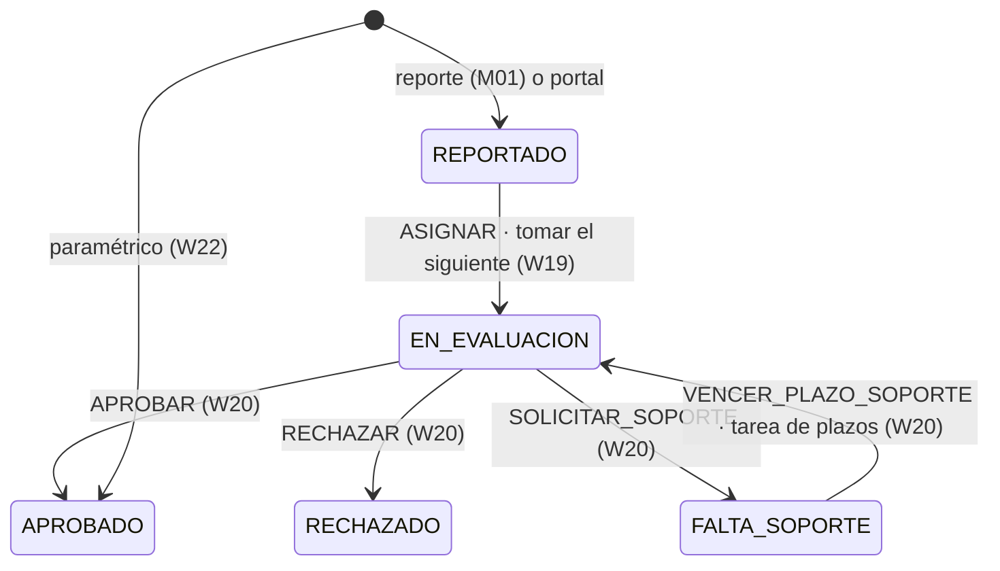

# HU-W20: peritaje para siniestro, la decisión del analista (servicio `siniestros`)

Documento de la historia [HU-W20](https://github.com/sjfuentes-uniandes/proyecto-final/issues/62) (Sprint 3, recorrido R7). Es la evidencia de contrato que pide el issue: la tabla de transiciones, el reloj en pausa, el plazo del soporte, el esquema que se agrega y los eventos. Amplía [HU-W19](hu-w19-detalle-siniestro.md); no recrea nada. Decisiones de diseño: DS3-02, DS3-04, DS3-10 a DS3-14 y DS3-24 del plan maestro del Sprint 3 (v1.3). Hallazgos y desviaciones: R-60 a R-70 de la bitácora.

Estado por fase: **B1 (contratos y documentación)** ✅ · B2 (dominio y migración) · B3 (aplicación, HTTP, tarea de plazos y `bff-web`) · F1–F2 (portal) · C (cierre).

## 1. Qué entrega la historia

El analista decide sobre un caso `EN_EVALUACION` que tiene asignado:

- **Aprobar** con la liquidación (valor reclamado, deducible y valor a indemnizar) y una justificación. Ordena el pago único: el caso pasa a `APROBADO` y `SiniestroAprobado` queda en el Outbox con la referencia `IND-<codigo>-01`.
- **Rechazar** con una causal de la lista cerrada, la explicación para el cliente y una justificación. El caso pasa a `RECHAZADO` y no habilita pago.
- **Solicitar soporte** (documentos, mensaje al cliente, canal y plazo en días hábiles). El caso pasa a `FALTA_SOPORTE` y el reloj del compromiso se pausa. Si el cliente no responde en el plazo, una tarea periódica devuelve el caso a la bandeja del mismo analista, en `EN_EVALUACION`, con el reloj reanudado.

Cada decisión conserva actor, fecha, justificación y evidencias consideradas en un historial inmutable. La repetición con la misma `Idempotency-Key` no repite el efecto.

Contratos: [`siniestros.yaml`](../contracts/openapi/siniestros.yaml) (interno) y [`bff-web.yaml`](../contracts/openapi/bff-web.yaml) (portal), con los eventos [`SiniestroAprobado`](../contracts/events/SiniestroAprobado.v1.schema.json), [`SiniestroRechazado`](../contracts/events/SiniestroRechazado.v1.schema.json) y [`SiniestroSoporteSolicitado`](../contracts/events/SiniestroSoporteSolicitado.v1.schema.json), y [`SiniestroEnEvaluacion`](../contracts/events/SiniestroEnEvaluacion.v1.schema.json) ampliado.

| Ruta | Para qué |
| --- | --- |
| `POST /v1/siniestros/{siniestroId}/decision` | La decisión. `Idempotency-Key` (UUID) obligatoria. Cuerpo `SolicitudDecision`, discriminado por `tipo` (`APROBAR`, `RECHAZAR`, `SOLICITAR_SOPORTE`). Responde 200 `ResultadoDecisionSiniestro` |
| `GET /v1/siniestros/catalogos-decision` | Causales, documentos solicitables, canales y plazos, como **códigos** que el portal traduce. Se registra antes de `GET /{siniestroId}` |

`bff-web` expone las mismas dos rutas con el grupo `analistas-siniestros`, propaga la `Idempotency-Key` y envía `X-Actor-Id`, `X-Actor-Rol` y `X-Actor-Nombre` (R-34 de W19).

## 2. Estados y tabla de transiciones (DS3-02)

La tabla es una **función pura del dominio** (`domain/siniestro/transiciones.py`). Cada par (estado × acción) que no está en la columna «Hacia» es inválido y responde 409 `TRANSICION_NO_PERMITIDA` sin cambiar el estado ni el historial. Son 25 pares: 5 válidos y 20 inválidos; la prueba UT-W20-01 los recorre todos.

| Estado origen | `ASIGNAR` | `APROBAR` | `RECHAZAR` | `SOLICITAR_SOPORTE` | `VENCER_PLAZO_SOPORTE` |
| --- | --- | --- | --- | --- | --- |
| `REPORTADO` | **`EN_EVALUACION`** (W19) | ✖ | ✖ | ✖ | ✖ |
| `EN_EVALUACION` | ✖ | **`APROBADO`** | **`RECHAZADO`** | **`FALTA_SOPORTE`** | ✖ |
| `FALTA_SOPORTE` | ✖ | ✖ | ✖ | ✖ | **`EN_EVALUACION`** |
| `APROBADO` | ✖ | ✖ | ✖ | ✖ | ✖ |
| `RECHAZADO` | ✖ | ✖ | ✖ | ✖ | ✖ |

Notas:

- `APROBADO` y `RECHAZADO` son terminales. Un caso `APROBADO` solo cambia de **pago** (W23), no de estado.
- Un caso `FALTA_SOPORTE` no admite ninguna decisión del analista: solo sale por el vencimiento del plazo (DS3-13). Que el cliente cargue el soporte y reabra el caso antes del plazo es del móvil y está fuera de alcance.
- Un caso `REPORTADO` no se decide: primero se toma de la cola (`ASIGNAR`).
- Los paramétricos (W22) **nacen** `APROBADO`; no son una transición.
- La acción `VENCER_PLAZO_SOPORTE` solo la ejecuta la tarea de plazos, nunca una ruta HTTP.

## 3. Quién decide y en qué orden se valida

Solo el analista **asignado** decide (DS3-03); `siniestros` exige `X-Actor-Rol = ANALISTA_SINIESTROS` y `bff-web`, el grupo `analistas-siniestros` (HU-W19, §2). Un 403 se audita como en W19.

El orden de las comprobaciones es parte del contrato: una decisión que falla en un paso no llega a los siguientes ni escribe nada.

| # | Comprobación | Si falla |
| --- | --- | --- |
| 1 | **Forma del cuerpo** (Pydantic): `tipo` conocido, ningún campo de más (`additionalProperties: false`), enumerados, longitudes, `documentos` con 1 a 4 elementos, `plazoDiasHabiles` ∈ {5, 10, 15}, montos como texto decimal | 422 `SOLICITUD_INVALIDA` (`detalles.campos`: la ruta del campo **sin** el prefijo del `tipo` que antepone Pydantic, p. ej. `documentos` o `liquidacion.valorIndemnizar`; un `tipo` ausente o desconocido es `tipo`) |
| 2 | **Contenido sin base de datos.** `justificacion` vacía o solo espacios; en el rechazo, `causal` fuera de la lista y `explicacionCliente` vacía; en el soporte, `mensajeCliente` vacío | 422 `JUSTIFICACION_REQUERIDA`, `CAUSAL_INVALIDA` o `SOLICITUD_INVALIDA` |
| 3 | **Idempotencia** (§6): la clave `decision:<Idempotency-Key>` ya existe | Misma huella: 200 con el resultado original. Otra huella: 422 `IDEMPOTENCIA_CONFLICTO` |
| 4 | **Bloqueo** del siniestro (`FOR UPDATE`) | 404 `SINIESTRO_NO_ENCONTRADO` |
| 5 | **Transición** (§2) | 409 `TRANSICION_NO_PERMITIDA` con `detalles.estadoActual` |
| 6 | **Analista asignado** | 409 `CASO_ASIGNADO_A_OTRO` |
| 7 | **Contenido que necesita el caso.** Las evidencias consideradas pertenecen al siniestro; la liquidación (§5) | 422 `SOLICITUD_INVALIDA` o `VALOR_FUERA_DE_RANGO` |
| 8 | **Escritura** (§7) | — |

La transición va **antes** que el analista asignado (R-66): un caso ya decidido responde siempre `TRANSICION_NO_PERMITIDA`, sin revelar a quién pertenecía, y un caso `REPORTADO` (sin analista) también.

`justificacion` y `causal` se declaran como texto en el contrato (no como enumerado) para que su error tenga código propio: un enumerado que Pydantic rechaza respondería `SOLICITUD_INVALIDA` (R-64). Los valores válidos de `causal` salen de `catalogos-decision`.

## 4. Reloj del compromiso en pausa (DS3-04) y plazo del soporte

El reloj de W19 se calcula **al leer** con `reportado_en`, `pausa_acumulada_s`, `pausado_desde` y `decidido_en` (ver W19, §4). W20 solo escribe esas columnas:

| Acción | `pausado_desde` | `pausa_acumulada_s` | `plazo_soporte_vence_en` | `decidido_en` |
| --- | --- | --- | --- | --- |
| `APROBAR`, `RECHAZAR` | — | — | — | `ahora` (el reloj se detiene) |
| `SOLICITAR_SOPORTE` | `ahora` | — | `ahora` + N días hábiles | — |
| `VENCER_PLAZO_SOPORTE` | `NULL` | `+ floor(ahora − pausado_desde)` en segundos, sin bajar de 0 | `NULL` | — |

Mientras el caso está en `FALTA_SOPORTE` el tiempo restante no baja: se descuenta `ahora − pausado_desde`. Al volver a `EN_EVALUACION` queda lo que había al pausar. El caso reaparece en la bandeja del analista (H01) con ese tiempo, no con 48 h nuevas.

**Días hábiles (R-68).** Lunes a viernes, **sin festivos** (DS3-12). La fecha de calendario es la de Colombia (UTC−5 fijo, como R-20 de W19). Se cuenta desde el día **siguiente** al de la solicitud, sumando solo los días hábiles, y se conserva la hora local del día de la solicitud. El instante resultante se guarda en UTC.

| Solicitud (hora de Colombia) | N | Vence |
| --- | --- | --- |
| lunes 10:00 | 5 | lunes siguiente 10:00 |
| jueves 16:00 | 5 | jueves siguiente 16:00 (cruza un fin de semana) |
| viernes 16:00 | 5 | viernes siguiente 16:00 |
| sábado 09:00 | 5 | viernes siguiente 09:00 (la semana empieza el lunes) |
| domingo 23:30 | 10 | viernes de la segunda semana 23:30 |

El dominio no lee el reloj: el instante llega como parámetro.

## 5. Liquidación (H03 y H06)

`liquidacion` viaja solo en `APROBAR`. Montos como texto decimal (DS2-16), con **a lo sumo dos decimales**; se guardan en `numeric(18,2)` y salen con dos decimales (`"2500000.00"`). Si alguna regla falla, 422 `VALOR_FUERA_DE_RANGO` con `detalles.campos`:

| Regla | Campo en `detalles.campos` |
| --- | --- |
| `0 < valorIndemnizar ≤ valorReclamado` | `liquidacion.valorIndemnizar` |
| `0 ≤ deducible ≤ valorReclamado` | `liquidacion.deducible` |
| `valorIndemnizar ≤` suma asegurada del amparo reclamado (`causa`, R-05 de W19) | `liquidacion.valorIndemnizar` |
| `moneda` = la de la póliza (y la del siniestro, si consta) | `liquidacion.moneda` |
| Si el siniestro ya trae `valor_reclamado` (lo llena M01), debe coincidir | `liquidacion.valorReclamado` |
| Más de dos decimales o más de 16 dígitos enteros | el campo afectado |

No se exige que `valorIndemnizar = valorReclamado − deducible`: en H03 el analista edita «Valor a indemnizar» (R-67). Si el siniestro no trae `valor_reclamado` (la semilla de QA no lo trae), se acepta el de la solicitud y queda en la liquidación; **no** se escribe en `siniestros.valor_reclamado`, que es de M01.

El detalle ya muestra lo necesario para llenar el formulario y el diálogo H06 sin duplicar reglas en el portal: `valorReclamado` (null si no consta), `poliza.amparos[].sumaAsegurada`, `poliza.beneficiario.cuentaMascarada` y `referenciaPagoPrevista` (`IND-<codigo>-01`, DS3-11). El nombre del beneficiario lo compone `bff-web` desde `clientes` (`clienteNombre`). Una vez aprobado, `liquidacion` trae los tres montos, `referenciaPago` y `aprobadaEn` (R-63).

## 6. Idempotencia (DS3-12, R-29)

Se reutiliza la tabla `idempotencia` de W19, sin columna nueva:

| Dato | Valor |
| --- | --- |
| `clave` | `decision:<Idempotency-Key>` (global; el prefijo la separa de `siguiente:`) |
| `huella_solicitud` | `sha256("POST /v1/siniestros/{id}/decision" · siniestroId · actorId · cuerpo normalizado)`. El cuerpo se normaliza: textos sin espacios en los extremos, `documentos` y `evidenciasConsideradas` ordenados y montos con dos decimales |
| `respuesta` | El `ResultadoDecisionSiniestro` original |

- Misma clave y misma huella → 200 con la respuesta guardada, **sin volver a leer el estado** y sin filas nuevas (decisión, historial ni Outbox).
- Misma clave y otra huella (otro cuerpo, otro actor u otro siniestro) → 422 `IDEMPOTENCIA_CONFLICTO`.
- Dos solicitudes simultáneas con la misma clave se serializan con `pg_advisory_xact_lock` sobre la clave (como R-29).
- Las decisiones con claves **distintas** sobre el mismo caso las serializa el `FOR UPDATE` del siniestro: gana la primera y las demás reciben 409 `TRANSICION_NO_PERMITIDA`. La restricción única de §7 es la segunda barrera: si algún día se escribiera una segunda decisión final, la base la rechaza y la ruta responde ese mismo 409.

## 7. Esquema de datos que agrega la migración `002_decisiones.sql`

SQL idempotente con su `down/`, aplicado por `migrar()` al arrancar. **No repite** lo que ya existe en `001_siniestros.sql`: `valor_reclamado`, `moneda`, `decidido_en`, `pausado_desde`, `pausa_acumulada_s` y `plazo_soporte_vence_en`.

**`decisiones_siniestro`** (inmutable: el mismo tipo de disparador de solo inserción que `historial_siniestro`)

| Columna | Tipo | Notas |
| --- | --- | --- |
| `id` | `uuid` PK | Es el `decisionId` de la respuesta |
| `siniestro_id` | `uuid` FK | |
| `tipo` | `text` `CHECK` | `APROBAR`, `RECHAZAR`, `SOLICITAR_SOPORTE` |
| `idempotency_key` | `uuid` único | La clave tal cual llegó |
| `huella_solicitud` | `text` | Ver §6 |
| `detalle` | `jsonb` | Aprobar: liquidación y `referenciaPago`. Rechazar: `causal` y `explicacionCliente`. Soporte: `documentos`, `canal`, `plazoDiasHabiles`, `plazoVenceEn` y `mensajeCliente`. `COMMENT ON COLUMN … IS 'sensible'`: lleva la explicación y el mensaje al cliente, que **no** salen de esta tabla hacia logs, eventos ni historial |
| `actor_id` | `text` | |
| `registrada_en` | `timestamptz` | |

Restricción **única parcial** `(siniestro_id) WHERE tipo IN ('APROBAR', 'RECHAZAR')`: una sola decisión final por siniestro. Pueden existir varias decisiones `SOLICITAR_SOPORTE` (el caso puede pedir soporte, volver y pedirlo otra vez).

**`siniestros`** (columnas nuevas, nulas hasta aprobar)

| Columna | Tipo | Notas |
| --- | --- | --- |
| `deducible` | `numeric(18,2)` | `CHECK (deducible >= 0)` |
| `valor_indemnizar` | `numeric(18,2)` | `CHECK (valor_indemnizar > 0)`. Lo llena W20 al aprobar y W22 al crear un paramétrico |

Con las `CHECK` de 001 siguen cumpliéndose en cada transición (la prueba de migración las recorre): analista según el estado, pausa solo en `FALTA_SOPORTE` y `decidido_en` solo en un caso decidido. La migración agrega dos más, de la misma familia (R-22 de W19), y un índice para la tarea de plazos:

- `siniestros_plazo_segun_estado`: `plazo_soporte_vence_en` existe si y solo si el estado es `FALTA_SOPORTE`.
- `siniestros_liquidacion_segun_estado`: `valor_indemnizar` existe si y solo si el estado es `APROBADO`.
- `siniestros_plazo_soporte (plazo_soporte_vence_en) WHERE estado = 'FALTA_SOPORTE'`.

El historial no cambia de esquema (`accion` ya es un código abierto, R-10). Sigue sin admitir `UPDATE` ni `DELETE`.

## 8. Historial (DS3-14)

Toda transición escribe, en la **misma transacción**, el cambio del agregado, la entrada del historial y la fila del Outbox. Acciones nuevas (código en mayúsculas):

| `accion` | Cuándo | `actor` | `justificacion` | `detalles` (sin PII) |
| --- | --- | --- | --- | --- |
| `APROBADO` | Aprobar | El analista (id, rol y nombre) | La del analista | `valorIndemnizar`, `moneda`, `referenciaPago` |
| `RECHAZADO` | Rechazar | El analista | La del analista | `causal` |
| `SOPORTE_SOLICITADO` | Solicitar soporte | El analista | La del analista | `documentos`, `canal`, `plazoDiasHabiles`, `plazoVenceEn` |
| `PLAZO_SOPORTE_VENCIDO` | La tarea de plazos | `SISTEMA` (sin id ni nombre) | — | `plazoVenceEn` |

`evidencias_consideradas` guarda los ids de la solicitud. La explicación y el mensaje al cliente **no** entran al historial: viven en `decisiones_siniestro.detalle`.

**Trámite de H03** (se deriva del estado y del historial, como en W19): al aprobar o rechazar, `DECISION` queda `COMPLETADO` con la fecha y el nombre del analista; `PAGO_INDEMNIZACION` queda pendiente hasta W23. En `FALTA_SOPORTE` el paso actual sigue siendo `EN_EVALUACION`.

**Soportes pendientes** (`soportesPendientes`): mientras el caso está en `FALTA_SOPORTE`, los documentos pedidos que no estén presentes salen con estado `SOLICITADO`, aunque no sean de los requeridos por el amparo. Al volver a `EN_EVALUACION` por el plazo, se muestran otra vez como `FALTA` los que sigan sin estar presentes.

## 9. Eventos (todos por Outbox)

| Evento | Cuándo | Consumidor | Lleva | **No** lleva |
| --- | --- | --- | --- | --- |
| `SiniestroAprobado` (DS3-24) | Aprobar (y, desde W22, al nacer un paramétrico) | `dinero`, cola `dinero-indemnizaciones` (W23) y `consulta` | `siniestroId`, `codigo`, `origen`, `polizaId`, `clienteId`, `valorIndemnizar`, `moneda`, `referenciaPago` (`IND-<codigo>-01`), `beneficiarioRef`, `aprobadoEn`, `decididoPor` (null si es paramétrico) | La cuenta del beneficiario, nombres |
| `SiniestroRechazado` | Rechazar | `consulta` | `siniestroId`, `codigo`, `polizaId`, `causal`, `decididoPor`, `decididoEn` | La explicación al cliente |
| `SiniestroSoporteSolicitado` | Solicitar soporte | `consulta` | `siniestroId`, `codigo`, `polizaId`, `documentos`, `canal`, `plazoVenceEn`, `decididoPor` | El mensaje al cliente |
| `SiniestroEnEvaluacion` | Tomar el caso (`ASIGNACION`) o vencer el plazo (`PLAZO_SOPORTE_VENCIDO`) | `consulta` | Sin cambios; el enum `motivo` gana un valor | |

Todos empiezan por `Siniestro`, así que los recibe la cola `consulta-proyeccion` (prefijo `Siniestro`); solo `SiniestroAprobado` entra a `dinero-indemnizaciones`. `aggregateId` = `siniestroId`. Los campos extra respecto del plan (`decididoPor` en `SiniestroAprobado`; `codigo` y `polizaId` en los otros dos) son aditivos y están en R-65. **Avisos:** `consulta`/M05 (el nuevo valor de `motivo` y los tres tipos) y W23 (`SiniestroAprobado`, que solo se **escribe** aquí; quien lo consume es W23).

## 10. Tarea de plazos (DS3-13, reescrita en la v1.3)

Una tarea periódica **en proceso** dentro de `siniestros` (patrón de `dinero/main.py`: se lanza al arrancar y se detiene en dos fases al apagar; intervalo de 60 s). Operación medida `siniestro.plazos`.

1. En una transacción corta toma un lote de casos `FALTA_SOPORTE` con `plazo_soporte_vence_en < ahora`, con `FOR UPDATE SKIP LOCKED` (dos réplicas nunca toman el mismo caso).
2. Cada caso pasa a `EN_EVALUACION` **con el mismo analista** (la base exige analista en ese estado y la cola «Sin asignar» solo lista `REPORTADO`, R-45 de W19). El caso reaparece en «Mi bandeja» del analista, para evaluarse con la evidencia disponible, como dice H05.
3. Reanuda el reloj (§4), escribe el historial `PLAZO_SOPORTE_VENCIDO` y `SiniestroEnEvaluacion` con `motivo = PLAZO_SOPORTE_VENCIDO`, todo en la misma transacción.
4. Repite hasta vaciar los vencidos; no retiene conexiones fuera de esas transacciones ni llama a otros servicios.

El criterio técnico del plan («sin analista») quedó superado por esta redacción (R-60). Fuera de alcance (issue): los recordatorios de los días 3 y 8 (H05 solo muestra el texto) y que el cliente cargue el soporte desde la app.

## 11. Pantallas y la API

| Pantalla | Qué usa | Qué envía |
| --- | --- | --- |
| **H03** · panel y liquidación | `estado`, `analistaId` (visible solo si `EN_EVALUACION` y es del usuario), `valorReclamado`, `poliza.amparos`, `soportesPendientes` | `APROBAR` desde el diálogo H06 |
| **H06** · confirmar aprobación | `liquidacion` del formulario, `clienteNombre`, `poliza.beneficiario.cuentaMascarada`, `referenciaPagoPrevista`, `soportesPendientes` (aviso «Apruebas con un soporte pendiente»; queda en la justificación) | `Idempotency-Key` generada **una vez por apertura** del diálogo: el doble clic no duplica |
| **H05** · solicitar soporte | `catalogos-decision` (documentos, canales y plazos), `soportesPendientes`, `codigo` | `SOLICITAR_SOPORTE`. «Aprobar sin este soporte» y «Volver a la evaluación» solo navegan |
| **H07** · rechazo motivado | `catalogos-decision` (causales), `fechaEvento`, `poliza.vigencia`, `verificacionCobertura` | `RECHAZAR`; «Confirmar el rechazo» deshabilitado sin causal ni explicación (AC5) |
| Transición no permitida | 409 `TRANSICION_NO_PERMITIDA` | El portal muestra el error y recarga el detalle (sin mockup) |

## 12. Recorrido local

Se completa en la fase B3, con la guía de §9 de HU-W19 como base: aprobar EVA-01, repetir con la misma clave, rechazar VEN-01 con `POLIZA_NO_VIGENTE`, solicitar soporte en otro caso, vencer el plazo con un reloj adelantado, decidir un caso ya decidido (409) y revisar las filas de `outbox` y de `historial_siniestro` (un `UPDATE` debe fallar).

## 13. Pendientes con otras personas

| Tema | Con quién |
| --- | --- |
| Nuevo valor `PLAZO_SOPORTE_VENCIDO` en `SiniestroEnEvaluacion` y los tres eventos de decisión, para que `consulta` los proyecte (M05) | `npaezt` |
| `SiniestroAprobado` (DS3-24) como contrato de entrada de `dinero` | HU-W23 (la misma persona) y `Santi-MISO` (revisa `adaptador-pagos`) |
| Entrega al cliente del `mensajeCliente` por push o correo: no existe consumidor ni API que lo lea (el evento no lo lleva a propósito). Se define en la sincronización final (§2.7) | La persona |
| Aceptación de W19 y MAN-W19-01 | Otra persona |
