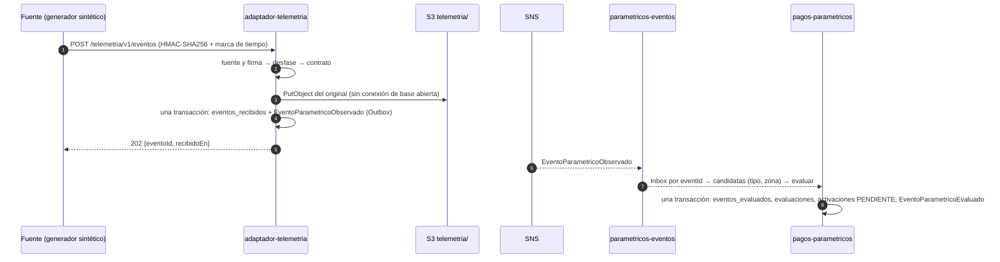

# HU-W21 · Validación de evento externo

Issue: [sjfuentes-uniandes/proyecto-final#63](https://github.com/sjfuentes-uniandes/proyecto-final/issues/63). Recorrido R5 (telemetría → evaluación). Sin pantallas: el seguimiento (H09) es de HU-W22 y la cola de descarte (H10 y H11), de HU-W24.

Dos servicios, una sola decisión por evento:

- `adaptador-telemetria` (aliado `telemetria`) **autentica y valida** cada evento externo firmado, guarda el original y lo publica por su Outbox.
- `pagos-parametricos` **evalúa** ese evento una sola vez contra su copia local de coberturas paramétricas. **No crea siniestros**: deja `activaciones` en `PENDIENTE` y eso es de HU-W22.



Contratos: [`adaptador-telemetria.yaml`](../contracts/openapi/adaptador-telemetria.yaml), [`EventoParametricoObservado.v1`](../contracts/events/EventoParametricoObservado.v1.schema.json), [`EventoParametricoEvaluado.v1`](../contracts/events/EventoParametricoEvaluado.v1.schema.json), [`PolizaEmitida.v1`](../contracts/events/PolizaEmitida.v1.schema.json) (con `coberturaParametrica`) y los datos de [`eventos-parametricos.json`](../contracts/datos-sinteticos/eventos-parametricos.json).

## 1. Entrada: `POST /v1/eventos`

La entrada pública es `POST /telemetria/v1/eventos` (API Gateway, HU-S03). Llega al adaptador como `POST /v1/eventos`, **sin JWT y con el cuerpo intacto**: la autenticidad es la firma. La fuente es un generador sintético (`IDEAM-SIM`, `AEROCIVIL-SIM`); nunca un proveedor real.

| Encabezado | Contenido |
| --- | --- |
| `X-Telemetria-Fuente` | Una de `TELEMETRIA_FUENTES` (por omisión `IDEAM-SIM` y `AEROCIVIL-SIM`) |
| `X-Telemetria-Marca-Tiempo` | Instante UTC ISO 8601 con `Z` en que la fuente firmó el envío |
| `X-Telemetria-Firma` | `sha256=<hex>` |

### 1.1 Firma

```
firma = "sha256=" + hex( HMAC-SHA256( secreto, marca_tiempo + "." + cuerpo_crudo ) )
```

- `secreto` es `hmac_secret` de `ALLY_TELEMETRIA_CREDENTIALS` (JSON `{"hmac_secret": …}` que inyecta la infraestructura desde Secrets Manager; en `compose.yaml`, un valor sintético). Hay **un solo secreto** para el aliado.
- `marca_tiempo` es el valor del encabezado **tal cual**, como texto.
- `cuerpo_crudo` son los **bytes recibidos**, sin parsear ni reformatear: un espacio de más cambia la firma. Por eso la ruta lee el cuerpo antes de parsearlo y no lo declara como parámetro.
- La comparación es de tiempo constante (`hmac.compare_digest`).

Ejemplo con un secreto de ejemplo (`secreto-de-ejemplo`, que **no** es el de ningún ambiente):

```text
marca  = 2026-11-10T14:00:05Z
cuerpo = {"versionContrato":"1","idExterno":"IDEAM-2026-1110-0001","eventoOrigen":"EVT-2026-0913","tipoEvento":"LLUVIA_ACUMULADA","valorObservado":"135","unidad":"mm","zona":"11001","observadoEn":"2026-11-10T14:00:00Z"}
firma  = sha256=2e718c810919919f16d77c37c48e5ebccd9e8ea9247839ff05c3d4eb3a7c8ff5
```

El eventoId de ese envío con la fuente `IDEAM-SIM` es `bafc2b26-7c88-5ae3-b5ac-26fdf5427a09`.

### 1.2 Orden de las comprobaciones y respuestas

| # | Comprobación | Si falla | Efecto |
| --- | --- | --- | --- |
| 1 | La fuente está en `TELEMETRIA_FUENTES` y la firma existe y coincide | 401 `FIRMA_INVALIDA` | No escribe nada |
| 2 | La marca de tiempo es un instante válido y está a ≤ 300 s del reloj (en cualquier sentido) | 401 `MARCA_TIEMPO_FUERA_DE_RANGO` | No escribe nada |
| 3 | El cuerpo es JSON y cumple `EventoExterno` (versión `"1"`, formatos, sin campos de más, `unidad` coherente con `tipoEvento`) | 422 `CONTRATO_INVALIDO` (`detalles.campos`, nunca valores) | No escribe nada |
| 4 | El evento ya se recibió (`eventos_recibidos`) | 200 con el mismo `eventoId` y `recibidoEn` | No archiva ni escribe |
| 5 | Archiva el original en S3 (corte de 300 ms) | 503 `DEPENDENCIA_NO_DISPONIBLE` | La fuente reenvía; es idempotente |
| 6 | Una transacción: `eventos_recibidos` y `EventoParametricoObservado` en el Outbox | 503 si la base falla; si otro envío ganó la carrera, 200 | |
| — | Todo bien | 202 `{eventoId, recibidoEn}` | |

- **La firma se verifica antes que el desfase.** Quien no puede firmar no averigua la ventana de tiempo, y un ausente o ilegible se responde igual que uno inválido (no se dice qué falló).
- **Un rechazo (401 o 422) no archiva ni escribe nada**: ni objeto en S3, ni fila de `eventos_recibidos`, ni fila de Outbox, ni cambios en `pagos-parametricos` (AC3).
- **El reenvío no vuelve a archivar** (paso 4): así el original que se conserva es siempre el del primer envío, y la clave del archivo (con la fecha del primer `recibidoEn`) no cambia si el reenvío llega otro día. Si dos envíos del mismo evento llegan a la vez, ambos archivan en la **misma clave** y `ON CONFLICT` decide: uno es 202 y el otro, 200, con una sola fila de Outbox.
- **Sin conexión de base mientras se espera a S3** (§13, regla 8): el paso 4 es una lectura corta y el 6 es una transacción corta; el `PutObject` queda entre las dos.

### 1.3 El evento canónico, `eventoId` y su identidad

`eventoId = uuid5(NAMESPACE_URL, "telemetria/<fuente>/<idExterno>")` (el mismo patrón de `semilla_qa.py`). Es determinista: el mismo `(fuente, idExterno)` produce siempre el mismo `eventoId`, aunque cambien la marca de tiempo, el formato del cuerpo o la fecha del envío. El `eventId` y el `aggregateId` del sobre de `EventoParametricoObservado` son ese `eventoId`, y `occurredAt` es `recibidoEn`.

El adaptador no publica el cuerpo crudo ni la firma ni la `ubicacion`: solo `fuente`, `idExterno`, `eventoOrigen`, `tipoEvento`, `valorObservado`, `unidad`, `zona`, `observadoEn`, `recibidoEn` y `archivoRef`.

### 1.4 El original y el reproceso de HU-W24 (§7 de `hu-w24-particiones.md`)

El original se archiva en el bucket de evidencias, con la clave

```
telemetria/<AAAA>/<MM>/<DD>/<eventoId>.json        (fecha UTC de recibidoEn; prefijo = TELEMETRIA_ARCHIVO_PREFIJO)
```

- El **cuerpo del objeto son los bytes recibidos**, tal cual (así la firma se puede volver a comprobar).
- Cada `PutObject` envía `ServerSideEncryption = EVIDENCIAS_BUCKET_SSE` (la política del bucket rechaza cualquier otro), `ContentType: application/json` y `ChecksumSHA256`.
- **Metadatos del objeto** (`x-amz-meta-`): `fuente`, `id-externo`, `evento-id` y `recibido-en`. La fuente viaja en un encabezado y no en el cuerpo, así que sin estos metadatos no se podría reconstruir el sobre desde el objeto.
- La clave es la misma de `archivoRef` del evento publicado.

Para reprocesar un evento que ya salió de `parametricos-eventos` (4 días) y de su DLQ (14 días), W24 §7 arma el sobre desde el objeto:

| Campo del sobre | De dónde sale |
| --- | --- |
| `eventId`, `aggregateId`, `payload.eventoId` | `evento-id` (o `uuid5(NAMESPACE_URL, "telemetria/" + fuente + "/" + idExterno)`) |
| `type` | `EventoParametricoObservado` (atributo `eventType` del mensaje) |
| `occurredAt`, `payload.recibidoEn` | `recibido-en` |
| `payload.fuente`, `payload.idExterno` | metadatos `fuente` e `id-externo` |
| `payload.eventoOrigen`, `tipoEvento`, `valorObservado`, `unidad`, `zona`, `observadoEn` | el cuerpo del objeto |
| `payload.archivoRef` | la clave del objeto |

Con el mismo `eventId`, el Inbox y la clave única `(evento_id, poliza_id)` descartan lo que ya se procesó: el reproceso es idempotente.

### 1.5 Configuración de `adaptador-telemetria`

| Variable | Por omisión | Qué es |
| --- | --- | --- |
| `ALLY_TELEMETRIA_CREDENTIALS` | — | JSON `{"hmac_secret": …}`; sin un secreto válido el servicio arranca, lo registra y rechaza todo envío con 401 (falla cerrada) |
| `TELEMETRIA_FUENTES` | `IDEAM-SIM,AEROCIVIL-SIM` | Fuentes autorizadas, separadas por comas |
| `SOLVENTA_DESFASE_MAX_S` | `300` | Desfase máximo de la marca de tiempo, en cualquier sentido |
| `SOLVENTA_S3_TIMEOUT_MS` | `300` (máximo 700) | Corte del `PutObject` del original, sin reintentos |
| `EVIDENCIAS_BUCKET`, `EVIDENCIAS_BUCKET_SSE`, `TELEMETRIA_ARCHIVO_PREFIJO` | —, `AES256`, `telemetria/` | Bucket de evidencias (HU-S03); sin bucket no se acepta ningún evento (503) |
| `OUTBOX_ENABLED`, `EVENTS_TOPIC_ARN` | `false`, — | Relay del Outbox hacia el tópico de eventos de negocio |
| `DB_*`, `SOLVENTA_DB_POOL_SIZE` | — , `5` | Base `adaptador_telemetria` (registro, Outbox e Inbox); `migrar()` aplica `001_telemetria.sql` al arrancar |

## 2. Contrato del evento externo (`EventoExterno` v1)

| Campo | Regla |
| --- | --- |
| `versionContrato` | `"1"`; otra versión es 422 |
| `idExterno` | `^[A-Za-z0-9._:-]{1,64}$` |
| `eventoOrigen` | Igual (p. ej. `EVT-2026-0913`): el fenómeno o incidente al que pertenece la medición |
| `tipoEvento` | `LLUVIA_ACUMULADA` o `RETRASO_VUELO` |
| `valorObservado` | Texto decimal `^[0-9]{1,9}(\.[0-9]{1,3})?$` |
| `unidad` | `mm` o `min`. **`LLUVIA_ACUMULADA` va en `mm` y `RETRASO_VUELO` en `min`**; otra combinación es 422 (JSON Schema no lo expresa: lo valida el dominio) |
| `zona` | `^[A-Z0-9]{2,16}$`: municipio DANE sintético (`11001` Bogotá, `05001` Medellín…) o código de vuelo (`AV204`) |
| `observadoEn` | Instante con zona; se normaliza a UTC |
| `ubicacion` | `{lat, lon}` opcional; no se publica ni se evalúa (minimización) |

El cuerpo no admite campos adicionales: un contacto o cualquier otro dato personal es 422.

## 3. Evaluación (DS3-21)

`evaluar(evento, candidatas)` es una función pura: sin E/S ni reloj. Una cobertura **activa** si se cumplen las cinco condiciones:

1. la cobertura está `ACTIVA` en la copia local;
2. mismo `tipoEvento`;
3. misma `zona`;
4. `observadoEn` está en `[vigenteDesde, vigenteHasta)` (el inicio incluido y el fin excluido);
5. `valorObservado ≥ umbral` (justo en el umbral activa; una unidad abajo, no).

Si no activa, la razón es la **primera** que falla en este orden de precedencia:

| # | Razón | Cuándo |
| --- | --- | --- |
| 1 | `POLIZA_NO_ACTIVA` | La cobertura no está `ACTIVA` |
| 2 | `FUERA_DE_VENTANA` | `observadoEn` fuera de `[vigenteDesde, vigenteHasta)` |
| 3 | `FUERA_DE_ZONA` | La zona del evento no es la de la cobertura |
| 4 | `BAJO_UMBRAL` | `valorObservado < umbral` |

La decisión del **evento** se deriva de las evaluaciones por póliza:

| `decision` | Cuándo | `razon` del evento |
| --- | --- | --- |
| `ACTIVA` | Al menos una póliza activó | `null` |
| `NO_ACTIVA` | Hubo candidatas y ninguna activó | `null` (la razón de cada póliza está en `evaluaciones`) |
| `SIN_POLIZAS` | No hubo candidatas | `SIN_POLIZAS_EN_ZONA` |

Cada evaluación guarda la `versionRegla` (la de la cobertura). `decision`, `razon`, `fuente` e `idExterno` quedan en `eventos_evaluados` y en `EventoParametricoEvaluado`, para conservar el origen y el porqué de cada decisión.

### 3.1 La ventana es la vigencia de la póliza

`coberturaParametrica` no trae ventana propia: es la `vigencia` de `PolizaEmitida` (fechas **inclusivas**, America/Bogota). `vigenteDesde` es el día `desde` a las 00:00 de Colombia y `vigenteHasta`, el día **siguiente** a `hasta` a las 00:00 de Colombia, en UTC con el desfase fijo de UTC−5 (R-20; sin horario de verano). Una vigencia `2026-11-02` a `2027-11-01` es `[2026-11-02T05:00:00Z, 2027-11-02T05:00:00Z)`.

### 3.2 Candidatas por índice, y qué razones se ven por póliza

La evaluación busca las candidatas con el índice `(tipo_evento, zona) WHERE estado = 'ACTIVA'` y no hace llamadas remotas (DS3-19). Eso fija qué razones aparecen en el recorrido completo:

- `FUERA_DE_VENTANA` y `BAJO_UMBRAL` aparecen **por póliza**, porque la candidata está activa y en la zona.
- Un evento en una zona **sin coberturas activas del tipo** (el caso «fuera de zona» de la matriz) no tiene candidatas: es `SIN_POLIZAS` con `SIN_POLIZAS_EN_ZONA`. La cobertura de otra zona no se evalúa ni se registra.
- `POLIZA_NO_ACTIVA` y `FUERA_DE_ZONA` son razones de la **función pura**: la verificación de H11 y los casos de borde las usan, pero con el índice parcial una cobertura cancelada o de otra zona nunca llega a ser candidata.

Es la lectura que concilia DS3-19 (candidatas por índice, sin recorrer todas las coberturas) con DS3-21; queda registrada en la bitácora (R-151).

### 3.3 Matriz de la fase de contratos

Los casos de [`eventos-parametricos.json`](../contracts/datos-sinteticos/eventos-parametricos.json) y su resultado esperado (el generador los contrasta con un evaluador de referencia independiente):

| Caso | Zona | Valor | `observadoEn` | Decisión | Por póliza |
| --- | --- | --- | --- | --- | --- |
| `valido` | 11001 | 135 mm | 10 nov 14:00Z | `ACTIVA` (1 de 2) | `COB-BOG-1` activa; `COB-BOG-2` `FUERA_DE_VENTANA` |
| `justoEnElUmbral` | 11001 | 120 mm | 10 nov 14:05Z | `ACTIVA` (1 de 2) | igual |
| `unaUnidadBajoElUmbral` | 11001 | 119 mm | 10 nov 14:10Z | `NO_ACTIVA` (0 de 2) | `COB-BOG-1` `BAJO_UMBRAL`; `COB-BOG-2` `FUERA_DE_VENTANA` |
| `fueraDeVentanaEnVigenteHasta` | 05001 | 150 mm | 1 nov 05:00:00Z | `NO_ACTIVA` (0 de 1) | `COB-MED-1` `FUERA_DE_VENTANA` (el fin está excluido) |
| `justoEnVigenteDesde` | 08001 | 130 mm | 2 nov 05:00:00Z | `ACTIVA` (1 de 1) | `COB-BAQ-1` activa (el inicio está incluido) |
| `unSegundoAntesDeVigenteDesde` | 08001 | 130 mm | 2 nov 04:59:59Z | `NO_ACTIVA` (0 de 1) | `COB-BAQ-1` `FUERA_DE_VENTANA` |
| `fueraDeZona` | 76001 | 200 mm | 10 nov 14:15Z | `SIN_POLIZAS` | `SIN_POLIZAS_EN_ZONA` |
| `retrasoDeVueloEnElUmbral` | AV204 | 180 min | 5 nov 18:30Z | `ACTIVA` (1 de 1) | `COB-VUELO-1` activa |

Los envíos rechazados (firma, marca de tiempo, contrato) y el duplicado no producen evaluación; el duplicado tampoco una segunda fila de Outbox.

## 4. Idempotencia

| Nivel | Mecanismo | Resultado |
| --- | --- | --- |
| `adaptador-telemetria` | `eventos_recibidos` con PK `evento_id`, `ON CONFLICT` | Reenvío → 200 con el mismo `eventoId`; una sola fila de Outbox |
| `parametricos-eventos` | Inbox por `eventId` (= `eventoId`) | El mismo mensaje entregado dos veces → una sola evaluación (AC4) |
| `pagos-parametricos` | `UNIQUE (evento_id, poliza_id)` en `evaluaciones` y `activaciones`; PK `evento_id` en `eventos_evaluados` | Aun si el Inbox fallara, no hay dos decisiones por póliza |

Un evento ya evaluado conserva su decisión original: reprocesarlo (H10, H11) usa el mismo `eventId`, así que no la rehace.

## 5. Cobertura paramétrica en la póliza (DS3-20, opción A)

`PolizaEmitida.v1` suma el campo **opcional** `coberturaParametrica` (cambio aditivo, sin subir la versión):

```json
"coberturaParametrica": {
  "tipoEvento": "LLUVIA_ACUMULADA", "zona": "11001", "umbral": "120", "unidad": "mm",
  "valorPago": "1400000.00", "moneda": "COP", "versionRegla": "1"
}
```

- `polizas` **todavía no lo llena**: el evento sale con `coberturaParametrica: null`. `consulta` lo ignora (lee con `extra="ignore"`) y `auditoria` guarda el sobre tal cual llegó. Que `polizas` lo emita desde el producto paramétrico de `catalogo` (opción B) queda para la sincronización final (§2.7 del plan, SYNC-03).
- `pagos-parametricos` crea la cobertura **solo si el campo viene**; sin él, la póliza no genera cobertura (queda en el Inbox y se ignora).
- La ventana es la `vigencia` de la póliza (§3.1).

### 5.0 El producto de QA `clima-lluvia` (W21-B04)

`catalogo` publica un producto paramétrico de prueba con la semilla de QA (`CATALOGO_PRODUCTOS_QA`, ya encendida en `int`): `clima-lluvia`, versión `2026.11.1`, ramo `PARAMETRICO`, una cobertura `LLUVIA_ACUMULADA` y el bloque **opcional** `parametrico` del producto:

```json
"parametrico": {"tipoEvento": "LLUVIA_ACUMULADA", "unidad": "mm", "umbral": "120", "valorPago": "1400000.00", "versionRegla": "1"}
```

- El bloque es aditivo: columna `productos.parametrico` (migración `005`), campo opcional de `ProductoRespuesta` que **no se serializa si es nulo** (la respuesta y la caché de los demás productos no cambian) y validación al sembrar (tipo de evento conocido, su unidad, umbral y valor de pago positivos con el formato de `coberturaParametrica`, y la cobertura que paga).
- Con la opción A, **`polizas` no lee el producto**: la cobertura de una póliza viaja en `PolizaEmitida`. Hoy el producto solo documenta la regla y sirve de dato de QA; sus reglas de prima (tasa 0,025 sobre 1 400 000 = prima de 35 000) coinciden con las pólizas de `eventos-parametricos.json`.
- La zona y la ventana no son del producto: son de cada póliza (`coberturaParametrica.zona` y su `vigencia`).

### 5.1 Orden de los eventos de póliza (DS3-22)

`coberturas_activas` (PK `poliza_id`) solo avanza con un orden **mayor**, para que una cancelación atrasada no reactive la cobertura. Como `polizas` no publica `aggregateVersion` (CF-S3-11), el orden es:

1. el `aggregateVersion` del sobre, si el evento y la fila guardada lo traen;
2. si no, el `occurredAt`.

Gana el más reciente; un empate no cambia el estado. Si un evento trae versión y el guardado no (o al revés), se comparan los `occurredAt`. Se reutiliza `solventa_common.versionado.avanza`, pero **no** `leer_version`: esa función lanza `EventoInvalido` cuando el sobre no trae `aggregateVersion`, y como `polizas` no lo publica mandaría **todas** las `PolizaEmitida` a la DLQ.

`polizas` tampoco publica `PolizaCancelada`. Mientras no exista, `pagos-parametricos` acepta una forma **sintética** (no hay esquema publicado: cuando `polizas` la emita, su esquema lo fija quien tenga ese servicio):

```json
{"eventId": "<uuid>", "aggregateId": "<polizaId>", "type": "PolizaCancelada", "version": 1,
 "occurredAt": "2026-11-10T11:00:00Z", "correlationId": "…", "aggregateVersion": 2,
 "payload": {"polizaId": "<polizaId>", "canceladaEn": "2026-11-10T11:00:00Z"}}
```

Los cinco escenarios de `ordenCoberturas` en [`eventos-parametricos.json`](../contracts/datos-sinteticos/eventos-parametricos.json) fijan el resultado: emisión y luego cancelación atrasada → `ACTIVA`; cancelación antes que la emisión → `CANCELADA`; lo mismo con `aggregateVersion` (la versión pesa más que el instante); empate → `ACTIVA`.

## 6. Seguridad y privacidad

- Nunca se registra (logs, trazas, métricas, errores, eventos): el secreto HMAC, la firma, el cuerpo de un evento externo, ni el original archivado. SEC-W21-01 lo comprueba buscando el secreto, la firma y el cuerpo en los registros capturados.
- El log de cierre de `telemetria.recibir` lleva solo `evento_id`, `fuente` y `resultado` (ver `contracts/operaciones.md`).
- El mismo envío con una marca vieja se rechaza por desfase (SEC-W21-01, repetición); la firma de un envío no sirve para otro cuerpo ni para otra marca.
- La fuente y el `idExterno` quedan en la evaluación: la trazabilidad del origen de cada decisión.
- Datos 100 % sintéticos. El secreto de desarrollo vive solo en `compose.yaml`; el de INT, en Secrets Manager (no se lee desde aquí).

## 7. Pruebas de la historia (plan §2.3, Fase 3)

| Id | Nivel | Qué |
| --- | --- | --- |
| UT-W21-01 | N1 | Firma (válida, un byte alterado, secreto incorrecto, fuente desconocida) y desfase (−300, +300, ±301 s) |
| UT-W21-02 | N1 | Clases de equivalencia y valores límite de ventana, zona y umbral; precedencia de razones |
| UT-W21-03 | N1 | Orden de DS3-22: `aggregateVersion` (mayor, igual, menor) y `occurredAt` (posterior, igual, anterior) |
| MT-W21-01 | N2 | `adaptador-telemetria` con PostgreSQL y LocalStack S3: archivo, Outbox, duplicado y rechazos sin efectos |
| MT-W21-02 | N2 | `pagos-parametricos` con PostgreSQL y LocalStack SNS/SQS, alimentado con `eventos-parametricos.json`, incluido el envenenado que termina en la DLQ |
| CT-W21-01 | N2 | Esquemas de los dos eventos, `test_openapi` de `adaptador-telemetria` y `PolizaEmitida.v1` con `coberturaParametrica` |
| E2E-W21-01 | N3 | Firma y envía a INT cada caso y verifica cada decisión (`tests/e2e/test_hu_w21_r5_evaluacion.py`; requiere el despliegue de INT y el secreto de prueba) |
| SEC-W21-01 | Seguridad | Repetición con firma vieja; secreto, firma y cuerpo fuera de los logs; trazabilidad del origen |

## 8. Lo que queda para otras historias

- **HU-W22** convierte las `activaciones` `PENDIENTE` en siniestros (`POST /v1/siniestros/parametricos`, con el gancho `reanudar` del Inbox) y compone H09.
- **Sincronización final (§2.7):** que `polizas` emita `coberturaParametrica` (y `aggregateVersion` y `PolizaCancelada`), y la alarma de degradación del aliado `telemetria` en `infra/apps/`.
