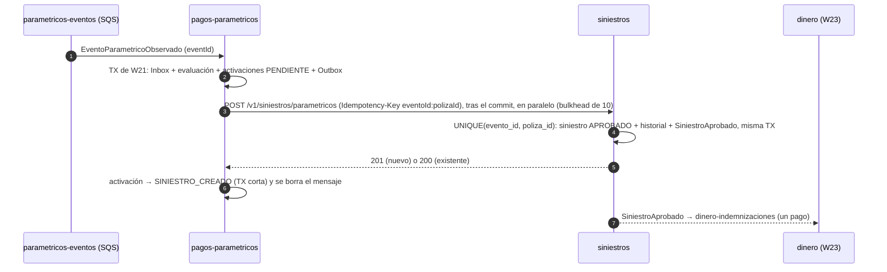

# HU-W22: creación del siniestro paramétrico (servicios `siniestros`, `pagos-parametricos` y `bff-web`)

Documento de la historia [HU-W22](https://github.com/sjfuentes-uniandes/proyecto-final/issues/64) (Sprint 3, recorrido R5). Es la evidencia de contrato que pide el issue: cómo una activación de [HU-W21](hu-w21-evento-parametrico.md) se convierte en **un** siniestro `APROBADO`, qué pasa si `siniestros` no responde, el gancho `reanudar` del Inbox común (DS3-15) y la vista de H09. Cierra el recorrido R5 con el pago de [HU-W23](hu-w23-indemnizacion.md).

Estado por fase: **B1 (contratos y documentación)** ✅ · **B2 (gancho del Inbox y creación en `siniestros`)** ☐ · **B3 (activaciones, resumen y `bff-web`)** ☐ · **F1 (portal)** ☐ · **C (cierre y pacto)** ☐.

## 1. Qué entrega la historia

Cada activación `PENDIENTE` que dejó W21 produce **un** siniestro `PARAMETRICO` `APROBADO`, aunque el mensaje llegue varias veces, lo procesen dos consumidores a la vez o se reprocese desde la DLQ:

- `pagos-parametricos` llama a `POST /v1/siniestros/parametricos` de `siniestros` **después** del commit de W21, con `Idempotency-Key = <eventoId>:<polizaId>`, y borra el mensaje solo cuando `siniestros` respondió por todas sus activaciones.
- `siniestros` escribe el siniestro, su historial `CREADO_AUTOMATICAMENTE` y `SiniestroAprobado` en **una** transacción. La clave única `(evento_id, poliza_id)` es la barrera de negocio. `dinero` (W23) lo paga una sola vez.
- Si `siniestros` no responde, el mensaje no se borra: SQS lo reentrega, el gancho `reanudar` reintenta las activaciones que siguen `PENDIENTE` y, tras 5 recepciones, el mensaje queda en la DLQ de `parametricos-eventos` (H10 y H11 de W24) con la alarma de HU-S03.
- El analista ve el siniestro en el portal con el bloque «Evento y regla aplicada» (AC3) y sigue el procesamiento en H09 «Siniestros paramétricos».

Contratos:

| Contrato | Qué |
| --- | --- |
| [`siniestros.yaml`](../contracts/openapi/siniestros.yaml) | `POST /v1/siniestros/parametricos` y `GET /v1/siniestros/parametricos/pagos?siniestroIds=`; `EventoParametricoDto` suma `eventoOrigen` |
| [`pagos-parametricos.yaml`](../contracts/openapi/pagos-parametricos.yaml) | `GET /v1/parametricos/resumen?eventoOrigen=` y `GET /v1/parametricos/eventos-origen?limite=`, junto a las rutas de descarte de W24 |
| [`bff-web.yaml`](../contracts/openapi/bff-web.yaml) | `GET /v1/siniestros/parametricos/resumen?eventoOrigen=` y `GET /v1/siniestros/parametricos/eventos-origen?limite=` (grupo `analistas-siniestros`) |
| [`pagos-parametricos-siniestros.json`](../contracts/pact/pagos-parametricos-siniestros.json) | Pacto consumidor `pagos-parametricos`, proveedor `siniestros`: creación, repetición e `Idempotency-Key` con otro cuerpo |
| [`SiniestroAprobado.v1`](../contracts/events/SiniestroAprobado.v1.schema.json) | Sin cambios: ya traía `origen = PARAMETRICO` y `decididoPor` null (R-65) |

## 2. Flujo



Nunca se retiene una conexión de base mientras se espera a `siniestros` (§13, regla 8): la llamada va en la continuación, después del commit, y cada respuesta se anota en una transacción corta.

## 3. `POST /v1/siniestros/parametricos` (DS3-23)

Uso interno. `X-Actor-Id = pagos-parametricos` y `X-Actor-Rol = SISTEMA_PARAMETRICO` (otro rol → 403 y `AccesoSiniestroDenegado`; sin actor, 401).

| Campo del cuerpo | Qué |
| --- | --- |
| `eventoId`, `polizaId`, `clienteId` | La clave de negocio y el cliente (el siniestro lo exige; `siniestros` no lo infiere) |
| `poliza` | `numero`, `ramo` (nombre), `vigencia {desde, hasta}` y `moneda`: lo que `pagos-parametricos` conoce de la cobertura. `siniestros` completa el resto de la copia (R-177 y R-178) |
| `evento` | `fuente`, `tipoEvento`, `valorObservado`, `umbral`, `unidad`, `zona`, `observadoEn` y `eventoOrigen` |
| `regla`, `versionRegla` | El código de la regla aplicada (DS3-21) y su versión |
| `valor`, `moneda` | Lo que paga la cobertura (texto decimal); `moneda` debe ser la de la póliza |

- **Clave y huella.** La `Idempotency-Key` debe ser `<eventoId>:<polizaId>` del cuerpo (si no, 422 `SOLICITUD_INVALIDA`). Se guarda en la tabla `idempotencia` de W19 con el prefijo `parametrico:` y la huella del cuerpo: la misma clave con otro cuerpo → 422 `IDEMPOTENCIA_CONFLICTO`.
- **Dos barreras.** La clave anterior y el índice único parcial `(evento_id, poliza_id) WHERE origen = 'PARAMETRICO'` (migración `003_parametricos.sql`, B2). La carrera se resuelve con `ON CONFLICT` y relectura: gana una transacción y las demás devuelven **200** con el mismo `id`.
- **El siniestro nace `APROBADO`**, sin analista (no aparece en «Sin asignar»), con `valorIndemnizar = valor` y `deducible = 0` (lo exige la CHECK `siniestros_liquidacion_segun_estado`, W20) y `decididoEn = ahora`. `evento_id` y `regla` (código y versión) quedan en sus columnas de W19.
- **Historial `CREADO_AUTOMATICAMENTE`** con `actorRol = SISTEMA_PARAMETRICO` y sin actor ni nombre, y `SiniestroAprobado` (`origen = PARAMETRICO`, `decididoPor` null, `referenciaPago = IND-<codigo>-01`) en el Outbox, en la misma transacción.
- **Respuesta:** `ResumenSiniestro`. `pagos-parametricos` solo lee `id` y `codigo`.

`GET /v1/siniestros/parametricos/pagos?siniestroIds=` (rol `ANALISTA_SINIESTROS`) devuelve, por lote de hasta 20, el `estadoPago` de cada paramétrico: el derivado de `PagoDto` (R-105, `PENDIENTE` hasta que `dinero` informa un resultado). Los ids inexistentes o de otro origen se omiten.

**Orden de las rutas.** `main.py` incluye el router de `/v1/siniestros/parametricos` **antes** que el de `/{siniestroId}`, como hizo W20 con `catalogos-decision`, para que `parametricos` nunca se lea como un identificador. En `bff-web`, igual con `/v1/siniestros/parametricos/…`.

## 4. Gancho `reanudar` del Inbox (DS3-15, nota técnica para la revisión)

> **Para `Santi-MISO` (autor del módulo en W16) y `sjfuentes-uniandes` (que lo extendió en W24).** El gancho se implementa en B2 en `libs/solventa-common/src/solventa_common/inbox.py`. Pedimos su revisión antes de G-W22; sin acuerdo, se concilia en SYNC-04 (plan §2.7).

**El problema (CF-S3-03).** En el modo (b) el manejador escribe su parte transaccional y devuelve una continuación que el consumidor ejecuta **después** del commit y **antes** de borrar el mensaje. Si la continuación falla, el mensaje no se borra, pero la reentrega encuentra el `eventId` en el Inbox, se trata como `duplicado` y **no repite la continuación**: el efecto externo que no terminó (aquí, crear el siniestro) no se reintenta y el mensaje se borra. W22 AC4 exige lo contrario («el mensaje se reintenta y, al agotar los intentos, queda en la DLQ»). Hacer la llamada HTTP dentro de la transacción del Inbox lo evitaría, pero retendría una conexión mientras se espera a `siniestros` (§13, regla 8).

**La propuesta.** Un parámetro opcional de `ConsumidorInbox`:

```python
reanudar: Callable[[EventoRecibido], Awaitable[Continuacion | None]] | None = None
```

| Situación | Comportamiento |
| --- | --- |
| `reanudar = None` (por omisión) | **Idéntico al actual.** `dinero`, `polizas`, `consulta` y `auditoria` no cambian |
| `eventId` nuevo | Igual que hoy: Inbox + manejador en una transacción y, después del commit, la continuación del modo (b). `reanudar` no interviene |
| `eventId` ya en el Inbox y `reanudar` existe | Se llama a `reanudar(evento)` **fuera de la transacción del Inbox** (la de la inserción ya terminó). Si devuelve una continuación, se ejecuta **antes de borrar**; si devuelve `None`, no hay nada pendiente y se trata como `duplicado` |
| La continuación reanudada falla, o `reanudar` lanza | `fallo_continuacion`, igual que una continuación fallida del primer intento: **no se borra**; el mensaje vuelve tras la visibilidad y, tras `maxReceiveCount` (5), SQS lo manda a la DLQ. `al_fallar` se llama como siempre |
| La continuación reanudada termina | Se borra. Desenlace `reanudado` |

- **Medición.** `inbox.consumir` con `outcome = reanudado` (éxito) o `fallo_continuacion` (con `error_type`). `Desenlace.procesado` incluye `reanudado`.
- **Ambos caminos.** `_aplicar` es el punto común del camino secuencial (HU-W16, `ejecutar_una_vez`) y del concurrente con latido de visibilidad (HU-W24, `concurrencia` y `visibilidad_s`): el gancho vive ahí, así que la continuación reanudada también tiene el latido, la parada con plazo y el `al_fallar` del consumidor común.
- **Quién decide qué queda pendiente.** El consumidor no sabe qué es «pendiente»: lo decide el servicio. `pagos-parametricos` devuelve la continuación si quedan activaciones `PENDIENTE` del evento y suma 1 a `duplicados` del evento (la entrega repetida que se descarta sin cambiar la decisión). Si no queda ninguna, devuelve `None`.
- **Dos consumidores a la vez con el mismo mensaje.** El segundo ve el `eventId` en el Inbox mientras el primero aún crea los siniestros; `reanudar` ve activaciones `PENDIENTE` y los dos llaman a `siniestros` con la misma `Idempotency-Key`. Es seguro (el segundo recibe 200 con el existente) y solo cuesta una llamada de más.
- **Efectos que no toca.** El Inbox sigue siendo «no repetir la transacción»; solo se agrega «y reanudar lo que quedó pendiente». No se cambia `leer_sobre`, el envenenado ni la parada.

**Por qué no basta con el modo (b) tal como está.** Alternativas descartadas: (1) no insertar en el Inbox hasta terminar la continuación: dos transacciones y una ventana en la que un duplicado concurrente ejecuta el manejador de W21 dos veces (el efecto de W21 ya es idempotente, pero se evaluaría de más); (2) una conciliación periódica propia de `pagos-parametricos`, como la de `dinero`: no cumple AC4 (no hay DLQ ni alarma) y agrega una tarea más.

**Pruebas (B2).** UT-W22-02: `reanudar` ausente (comportamiento actual), con continuación que funciona, con continuación que falla (no borra), con `reanudar` que lanza y con `None`, en el camino secuencial y en el concurrente; más las pruebas de `libs`, `dinero`, `polizas`, `consulta`, `auditoria` y `pagos-parametricos` sin cambios.

## 5. `pagos-parametricos`: activaciones y seguimiento de H09

**Activación (B3).** `adapters/outbound/siniestros_http.py` con `correlation.cliente_async()`, timeout de 600 ms (§13, regla 7: corte a 700 ms), `ProteccionDependencia` (*bulkhead* de 10 y circuito) e `Idempotency-Key = <eventoId>:<polizaId>`. El consumidor de `parametricos-eventos` pasa al modo (b) más `reanudar`, **conservando la forma de W24** (`concurrencia`, `visibilidad_s=30`, `plazo_parada_s=10`, `al_fallar`). La transacción de W21 no cambia.

- La continuación crea los siniestros de las activaciones `PENDIENTE` del evento, en paralelo y acotado por el *bulkhead*; cada respuesta pasa su activación a `SINIESTRO_CREADO` con `siniestro_id` en una transacción corta. Si alguna falla, la continuación lanza y el mensaje no se borra.
- Un timeout **después** del commit de `siniestros` no duplica: el reintento recibe 200 con el existente.
- Los datos que `siniestros` necesita y que la cobertura no guardaba (cliente, ramo) y lo que H09 muestra (código del siniestro y disparador) se agregan en B3 (R-177 y R-179).

**Seguimiento (B3).** `GET /v1/parametricos/resumen?eventoOrigen=` y `GET /v1/parametricos/eventos-origen?limite=`, lectura con índices por `evento_origen` y `evaluado_en`:

| Campo | Definición |
| --- | --- |
| `procesados` | Eventos distintos ya evaluados del origen (`eventos_evaluados`) |
| `recibidos` | `procesados` más `duplicados` (R-180) |
| `activados` | Activaciones del origen, con o sin siniestro todavía |
| `duplicados` | Entregas repetidas descartadas sin cambiar la decisión ni crear otro siniestro |
| `enDlq` | `GetQueueAttributes` de la DLQ de `parametricos-eventos` (el adaptador `dlq_sqs.py` de W24); null si no se puede leer |
| `ritmoPorMinuto` | Los últimos 15 minutos, completos (con ceros), del más antiguo al más reciente |
| `ultimosPagos` | Hasta 10 activaciones con siniestro, la más reciente primero |

## 6. `bff-web`: la vista de H09

`GET /v1/siniestros/parametricos/resumen?eventoOrigen=` compone (grupo `analistas-siniestros`):

1. `pagos-parametricos` (`/v1/parametricos/resumen`): la fuente principal. Si no responde, 503 `SERVICIO_NO_DISPONIBLE`.
2. CloudWatch: `cola.profundidad` (`ApproximateNumberOfMessagesVisible` de `parametricos-eventos`), `cola.consumidoresActivos` (`RunningTaskCount` del servicio) y, si `pagos-parametricos` no pudo leerla, la DLQ. Sin métrica o sin permiso de `cloudwatch:GetMetricData`, el campo es `null` y se registra para SYNC-01.
3. `siniestros` (`/v1/siniestros/parametricos/pagos`): el `estadoPago` de cada fila. Si no responde, `null`.

**Una fuente secundaria que falla nunca da 503.** El estado de pago sale de `siniestros` y no de `dinero`: `bff-web` no llama a `dinero` hasta SYNC-01. `p95VentaConsultaMs` es null mientras no exista la métrica (CF-S3-10): el portal oculta ese aviso.

## 7. Errores, operaciones y seguridad

- **Errores.** Ningún código nuevo (plan §1.8): `SOLICITUD_INVALIDA`, `IDEMPOTENCIA_CONFLICTO`, `ACTOR_REQUERIDO`, `ROL_NO_AUTORIZADO`, `DEPENDENCIA_NO_DISPONIBLE` y `SERVICIO_NO_DISPONIBLE`; [`codigos-error.md`](../contracts/codigos-error.md) amplía sus filas.
- **Operaciones** ([`operaciones.md`](../contracts/operaciones.md)): `siniestro.crear_parametrico` (`creado`, `existente`, `rechazado`, `error`), `parametrico.activar` (`ok`, `timeout`, `error`), `parametrico.resumen` (`pagos-parametricos` y `bff-web`) e `inbox.consumir` con `outcome = reanudado`.
- **Seguridad (SEC-W22-01).** La creación automática queda auditada: historial con actor `SISTEMA_PARAMETRICO` y `SiniestroAprobado` en la cola `auditoria`. Ni los logs ni los eventos llevan el valor observado, la fuente, el cuerpo del evento, el cliente ni el `beneficiarioRef`.

## 8. Pruebas de la historia (plan §2.5, Fase 3)

| Id | Nivel | Qué |
| --- | --- | --- |
| UT-W22-01 | N1 | Clave `<eventoId>:<polizaId>` y valor según la cobertura |
| UT-W22-02 | N1 | `inbox.py`: `reanudar` ausente, con continuación que funciona y con una que falla |
| MT-W22-01 | N2 | Dos consumidores concurrentes con el mismo mensaje sobre PostgreSQL real: un siniestro |
| MT-W22-02 | N2 | Timeout después del commit de `siniestros`: sin duplicado |
| MT-W22-03 | N2 | `siniestros` caído → reintentos → DLQ en LocalStack; recuperación sin duplicado |
| CT-W22-01 | N2 | Pacto `pagos-parametricos-siniestros.json`, `test_openapi` de los tres servicios y pacto del portal |
| WEB-W22-01 | N1 | H09 y bloque paramétrico: datos, vacío, campos `null`, alternativa accesible del gráfico y axe |
| E2E-W22-01 | N3 | Evento válido enviado dos veces: un siniestro y un `SiniestroAprobado`; el detalle aparece en el portal |
| SEC-W22-01 | Seguridad | Auditoría de la creación automática |

## 9. Cómo se generaron los contratos de B1

Los servicios ya existen pero aún no tienen el código de W22, y `test_openapi` compara cada YAML con `app.openapi()`. `docs/sprint_3/evidencias/hu-w22/prototipos/generar_contratos.py` arma una **copia temporal** de `siniestros`, `pagos_parametricos` y `bff_web` con los prototipos aplicados y escribe los YAML conservando su orden (R-176); no toca `services/`. `generar_pacto.py` escribe el pacto. Los prototipos son lo que B2 y B3 copian al código real.

`test_openapi` de `siniestros`, `pagos-parametricos` y `bff-web` **quedan en rojo hasta B2 y B3** (precedente R-13, R-61, R-108 y R-145): el de `siniestros` lo cierra B2 y los de `pagos-parametricos` y `bff-web`, B3.
