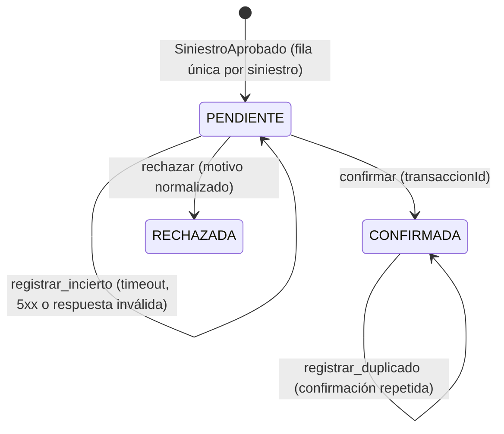

# HU-W23: procesamiento único de indemnización (servicios `dinero`, `adaptador-pagos` y `siniestros`)

Documento de la historia [HU-W23](https://github.com/sjfuentes-uniandes/proyecto-final/issues/65) (Sprint 3, recorridos R5 y R7). Es la evidencia de contrato que pide el issue: el flujo del pago, el modelo del movimiento, los eventos, los escenarios del aliado simulado y cómo se refleja el resultado en el siniestro. Amplía [HU-W16](adr/0013-recaudo-asincrono-por-oferta-aceptada.md) (el patrón del recaudo) y [HU-W20](hu-w20-decision-siniestro.md) (quien publica `SiniestroAprobado`); no recrea nada. Decisiones de diseño: [ADR 0015](adr/0015-indemnizacion-por-evento.md) (DS3-17, DS3-18, DS3-24, DS3-25, DS3-26 y CF-S3-02 del plan maestro del Sprint 3, v1.4). Hallazgos y desviaciones: R-103 en adelante de la bitácora.

Estado por fase: **B1 (contratos y documentación)** ✅ · **B2 (`adaptador-pagos` y simulador)** ✅ · **B3 (`dinero`)** ☐ · **B4 (`siniestros`, `bff-web` y recorrido local)** ☐ · **F1 (portal)** ☐ · **C (cierre y pacto)** ☐.

## 1. Qué entrega la historia

Un siniestro aprobado se paga **una sola vez**, aunque lleguen eventos o confirmaciones repetidos:

- `dinero` consume `SiniestroAprobado` (cola `dinero-indemnizaciones`) y registra **una** indemnización por siniestro. Paga por `adaptador-pagos`, que habla con el aliado `pagos` (en este proyecto, siempre el simulador).
- Un timeout o un 5xx de la pasarela deja la indemnización `PENDIENTE`: nunca se toma como rechazo. Una **conciliación** periódica, con `FOR UPDATE SKIP LOCKED`, consulta el estado y actualiza **la misma fila**.
- `dinero` publica `IndemnizacionConfirmada` o `IndemnizacionRechazada`. `siniestros` los consume (cola `siniestros-indemnizaciones`) y refleja el resultado en el caso: `pago`, el historial y el paso «Pago de la indemnización» del trámite. Un rechazo se presenta como «Pago por gestionar».
- `bff-web` expone la vista de H08 (`GET /v1/siniestros/{siniestroId}/pago`) y el portal muestra la pantalla «Siniestro aprobado y pago ordenado» y sus variantes.

Contratos:

| Contrato | Qué |
| --- | --- |
| [`adaptador-pagos.yaml`](../contracts/openapi/adaptador-pagos.yaml) | `POST /v1/desembolsos` y `GET /v1/desembolsos/{referencia}?beneficiarioRef=` (solo los llama `dinero`) |
| [`dinero.yaml`](../contracts/openapi/dinero.yaml) | `GET /v1/indemnizaciones?siniestroId=`, la primera ruta HTTP de `dinero` |
| [`bff-web.yaml`](../contracts/openapi/bff-web.yaml) | `GET /v1/siniestros/{siniestroId}/pago` → `PagoSiniestroVista` (grupo `analistas-siniestros`) |
| [`siniestros.yaml`](../contracts/openapi/siniestros.yaml) | Solo cambian descripciones: `PagoDto`, `EntradaHistorial` y `DetalleSiniestro` |
| [`IndemnizacionConfirmada.v1`](../contracts/events/IndemnizacionConfirmada.v1.schema.json) y [`IndemnizacionRechazada.v1`](../contracts/events/IndemnizacionRechazada.v1.schema.json) | Los eventos de `dinero` |
| [`SiniestroAprobado.v1`](../contracts/events/SiniestroAprobado.v1.schema.json) | La entrada de `dinero` (HU-W20) |

## 2. Flujo del pago

```mermaid
sequenceDiagram
    autonumber
    participant S as siniestros
    participant O as outbox → SNS
    participant D as dinero
    participant P as adaptador-pagos
    participant A as aliado pagos (WireMock)
    S->>O: SiniestroAprobado (misma TX que la decisión)
    O-->>D: cola dinero-indemnizaciones
    D->>D: TX: Inbox + indemnización PENDIENTE (ON CONFLICT: solo suma duplicados)
    Note over D: commit; la conexión se libera
    D->>P: POST /v1/desembolsos (referencia IND-…-01)
    P->>A: POST /pagos/v1/desembolsos (Idempotency-Key = referencia)
    A-->>P: CONFIRMADO | RECHAZADO | lento | caído
    D->>D: TX corta: CONFIRMADA | RECHAZADA (+ IndemnizacionConfirmada | Rechazada en el Outbox)
    O-->>S: cola siniestros-indemnizaciones → pago_*, historial y trámite
    Note over D,P: Si hubo timeout o 5xx, sigue PENDIENTE y la conciliación la resuelve (§5)
```

## 3. La indemnización en `dinero` (DS3-17)

Agregado propio `domain/indemnizacion/`, con la forma de `Recaudo`:



De `CONFIRMADA` y `RECHAZADA` no se sale. `registrar_duplicado` solo suma `duplicados_descartados`: no cambia el estado ni crea otro movimiento.

Tabla `indemnizaciones` (migración `002_indemnizaciones.sql`, con su `down/`; **no se toca `recaudos`**):

| Columna | Tipo | Nota |
| --- | --- | --- |
| `indemnizacion_id` | `uuid` PK | |
| `siniestro_id` | `uuid` | **`UNIQUE (siniestro_id, tipo)`** |
| `tipo` | `text` | `CHECK (tipo = 'INDEMNIZACION')` |
| `referencia` | `text` | única; `IND-<codigo>-01`, la clave idempotente hacia la pasarela |
| `monto` | `numeric(20,4)` | texto decimal en la API y en los eventos |
| `moneda`, `beneficiario_ref` | `text` | el `beneficiario_ref` es la referencia opaca de `SiniestroAprobado`: nunca la cuenta |
| `estado` | `text` | `PENDIENTE`, `CONFIRMADA` o `RECHAZADA` |
| `transaccion_id`, `motivo` | `text` | solo en el estado que corresponde |
| `intentos`, `duplicados_descartados` | `int` | llamadas efectivas de pago y repeticiones descartadas |
| `ultimo_incierto` | `text` | código del último intento incierto |
| `reclamado_hasta` | `timestamptz` | la conciliación (DS3-18) |
| `creado_en`, `actualizado_en`, `resuelto_en` | `timestamptz` | UTC |
| `correlation_id` | `text` | el del evento que la originó |

Un disparador `indemnizaciones_protegidas` (igual a `recaudos_protegidos`) impide `DELETE` y cualquier cambio de los campos de un movimiento final.

## 4. El consumidor de `dinero` (modo (b))

`adapters/inbound/sqs/siniestro_aprobado.py`, cola `dinero-indemnizaciones` (`SQS_DINERO_INDEMNIZACIONES_URL`), `ConsumidorInbox` de `solventa_common`. Todo dentro de `operacion("indemnizacion.pagar")`.

1. **Valida el sobre** contra `SiniestroAprobado.v1`: si no cumple, el mensaje es envenenado (`EventoInvalido`).
2. **Transacción:** inserta la fila `PENDIENTE` con `ON CONFLICT (siniestro_id, tipo) DO UPDATE SET duplicados_descartados = duplicados_descartados + 1`, sin tocar nada más. Misma transacción: el Inbox por `eventId`.
3. **Continuación** (después del commit y **solo si la fila es nueva**): pide el desembolso a `adaptador-pagos` **sin conexión de base abierta** y aplica el resultado en otra transacción corta, con el evento en el Outbox.
   - `CONFIRMADO` → `CONFIRMADA` + `IndemnizacionConfirmada`. `RECHAZADO` → `RECHAZADA` + `IndemnizacionRechazada`.
   - Timeout, 5xx o respuesta inválida → `registrar_incierto`: sigue `PENDIENTE`. Nunca se asume rechazo (ADR 0013, decisión 5).
   - Una confirmación repetida sobre una fila ya `CONFIRMADA` → `registrar_duplicado`, sin otro movimiento ni evento.
4. Si la continuación falla, la reentrega del mensaje **no** la repite (el Inbox ya tiene el `eventId`): por eso existe la conciliación.

Los tiempos son coherentes con la visibilidad de 60 s de la cola: el timeout hacia `adaptador-pagos` (6,5 s) supera al del adaptador hacia el aliado (5 s), y un ciclo del consumidor cabe de sobra en la visibilidad y en los 30 s de parada de ECS.

## 5. La conciliación (DS3-18)

`application/indemnizacion/conciliar.py`, lanzada desde `main.py` junto a la de recaudos (patrón `_lanzar`/`_detener`), con settings propios `indemnizacion_conciliacion_intervalo_s`, `indemnizacion_conciliacion_antiguedad_min_s` e `indemnizacion_conciliacion_lote`.

1. **Reclama:** en una transacción corta toma un lote de `PENDIENTE` con antigüedad ≥ `antiguedad_min_s` y `reclamado_hasta` vencido o nulo, con `FOR UPDATE SKIP LOCKED`, y marca `reclamado_hasta = ahora + 60 s`. Suelta la conexión.
2. **Consulta** `GET /v1/desembolsos/{referencia}?beneficiarioRef=` **después del commit**.
3. **Aplica** el resultado en otra transacción, con la guarda de `PENDIENTE`: `CONFIRMADA` o `RECHAZADA` en **la misma fila**, con su evento. Si el proveedor no conoce la referencia (`404 DESEMBOLSO_NO_ENCONTRADO`), reintenta `POST /v1/desembolsos` con la misma `referencia` (idempotente). Un incierto la deja `PENDIENTE`.
4. Mientras `reclamado_hasta` no venza, ninguna otra réplica toma el movimiento: dos réplicas no consultan dos veces el mismo.

Operación `indemnizacion.conciliar`; la métrica de antigüedad de pendientes se publica con la dimensión `tipo`, para que HU-S03 extienda `pending_collection_age_seconds`.

## 6. `adaptador-pagos` y el aliado simulado

`adaptador-pagos` agrega el recurso `desembolsos` con el estilo exacto de los cobros: la clave idempotente viaja en el cuerpo (`referencia`) y se reenvía al aliado como `Idempotency-Key`; una sola llamada, sin reintentos; mismas respuestas de error (504 `TIEMPO_AGOTADO`, 503 `FUENTE_NO_DISPONIBLE`, 502 `RESPUESTA_INVALIDA`) y 404 `DESEMBOLSO_NO_ENCONTRADO` en la consulta. La consulta lleva `beneficiarioRef`, como la de los cobros lleva `pagadorRef`: el aliado simulado no tiene memoria y elige el escenario por el beneficiario sintético (R-103).

El escenario lo elige el `beneficiarioRef` sintético de `SiniestroAprobado` (el aliado lo recibe como `beneficiario`), con mappings `services/simulador-aliados/mappings/pagos/desembolso-*.json`:

| `beneficiarioRef` | Desembolso | Consulta de estado |
| --- | --- | --- |
| `ben-sint-001` a `ben-sint-007` (los de la semilla de R7, salvo el último) | 200 `CONFIRMADO` con `transaccionId`, 50 ms | 200 `CONFIRMADO`, el mismo cuerpo |
| `ben-sint-008` (VEN-01 de la semilla) y `ben-sint-rechaza` | 200 `RECHAZADO` con `motivo` (`BENEFICIARIO_NO_HABILITADO`), 50 ms | 200 `RECHAZADO`, el mismo cuerpo |
| `ben-sint-lento` | 200 `CONFIRMADO` tras más de 700 ms (supera el timeout del adaptador; el desembolso sí ocurre) | 200 `CONFIRMADO` |
| `ben-sint-caido` | 503 | 404 `desembolso_no_encontrado` (la orden nunca llegó) |
| `ben-sint-duplicado` | 200 `CONFIRMADO` con un `transaccionId` fijo: la misma `referencia` devuelve siempre el mismo | 200 `CONFIRMADO`, el mismo `transaccionId` |

Cualquier otro valor cae en el respaldo de prioridad 10 (404 `referencia_no_reconocida`), como el resto de los aliados. El simulador es la única pasarela: ningún proveedor real y ningún dato de cuenta.

## 7. Eventos

Se generan desde el código (`uv run python -m dinero.adapters.outbound.eventos`) y nacen en el Outbox de `dinero` en la misma transacción que el resultado. Empiezan por `Indemnizacion`: los filtra la cola `siniestros-indemnizaciones` (prefijo) y los proyecta `consulta`; también llegan a `auditoria`.

| Evento | Payload |
| --- | --- |
| `IndemnizacionConfirmada` | `indemnizacionId`, `siniestroId`, `referencia`, `monto`, `moneda`, `transaccionId`, `intentos`, `duplicadosDescartados`, `confirmadaEn` |
| `IndemnizacionRechazada` | `indemnizacionId`, `siniestroId`, `referencia`, `motivo` (código normalizado), `intentos`, `duplicadosDescartados`, `rechazadaEn` |

`aggregateId` = `indemnizacionId`. `intentos` y `duplicadosDescartados` los usa el plan B de H08 (DS3-26). **Ningún dato de la cuenta del beneficiario**, ni su `beneficiarioRef`, ni cuerpos de la pasarela.

## 8. El resultado en `siniestros` (DS3-25)

`adapters/inbound/sqs/indemnizaciones.py`, cola `siniestros-indemnizaciones`, modo (a), dentro de `operacion("siniestro.resultado_pago")`. **Sin migración**: las columnas `pago_estado`, `pago_referencia`, `pago_transaccion_id`, `pago_motivo`, `pago_intentos` y `pago_duplicados_descartados` existen desde HU-W19.

- Una sola transacción: `pago_*`, la entrada del historial inmutable (`PAGO_CONFIRMADO` o `PAGO_RECHAZADO`) y el paso «Pago de la indemnización» del trámite.
- Un `Confirmada` repetido o fuera de orden **no cambia nada** (ni historial ni `pago_*`). El resultado de un siniestro inexistente o no `APROBADO` se descarta con log.
- **No reemite eventos.**
- `RECHAZADO` se presenta como «Pago por gestionar» (AC4): el siniestro sigue `APROBADO`; solo el pago queda por gestionar.

`pago` en el detalle (`PagoDto`) es null mientras el caso no esté `APROBADO`, y `PENDIENTE` mientras `dinero` no haya publicado un resultado: se **deriva al leer** (referencia prevista, contadores en 0), porque ningún evento marca el pago como pendiente y así cubre también los casos aprobados antes de W23 (R-105). `SIN_PAGO` no se emite.

## 9. La vista de H08 en `bff-web` (DS3-26, plan B)

`GET /v1/siniestros/{siniestroId}/pago` (grupo `analistas-siniestros`) → `PagoSiniestroVista`. Plan B: se arma **solo con `siniestros`** (el detalle ya trae la liquidación, el historial, la cuenta enmascarada y la proyección del pago) y el nombre del cliente de `clientes`, con la degradación de siempre (CF-S3-09: `clienteNombre` null si no responde). No llama a `dinero` (EXT-S3-02).

| Campo | Fuente |
| --- | --- |
| `siniestroId`, `codigo`, `estado`, `reportadoEn` | detalle de `siniestros` |
| `clienteNombre` | `clientes` (null si falla) |
| `compromisoHoras` | configuración de `bff-web` (48, DS3-04) |
| `liquidacion` | detalle: valor a indemnizar, deducible y referencia del pago |
| `cuentaMascarada` | `poliza.beneficiario.cuentaMascarada` (nunca la cuenta completa) |
| `autorizadoPor` | actor de la entrada `APROBADO` del historial (null si aprobó un paramétrico) |
| `historial` | detalle: la trazabilidad, incluidas `PAGO_CONFIRMADO` o `PAGO_RECHAZADO` |
| `indemnizacion` | proyección `pago_*` de `siniestros`; **null mientras `dinero` no publique un resultado** |

Un caso que no está `APROBADO` no tiene pago ordenado: 404 `INDEMNIZACION_NO_ENCONTRADA`. En la sincronización final (§2.7, SYNC-01), `indemnizacion` pasa a componerse con `GET /v1/indemnizaciones?siniestroId=` de `dinero`, **sin cambiar este contrato**: `IndemnizacionVista` solo lleva lo que ambas fuentes pueden llenar (el estado como `PENDIENTE`, `CONFIRMADO` o `RECHAZADO`, igual que `PagoDto`).

## 10. Errores, operaciones y seguridad

- Códigos nuevos en [`codigos-error.md`](../contracts/codigos-error.md): `INDEMNIZACION_NO_ENCONTRADA` (404, `bff-web`) y `DESEMBOLSO_NO_ENCONTRADO` (404, `adaptador-pagos`).
- Operaciones nuevas en [`operaciones.md`](../contracts/operaciones.md): `indemnizacion.pagar`, `indemnizacion.conciliar`, `desembolso.ordenar`, `desembolso.consultar`, `siniestro.resultado_pago` e `indemnizacion.consultar`.
- Ni los logs, ni las trazas, ni las métricas, ni los errores, ni los eventos llevan la cuenta del beneficiario, su nombre ni el `beneficiarioRef`: solo la referencia del pago y los identificadores (SEC-W23-01).
- `dinero` figura sin *listener* en `infra/platform/catalog.tf` (`listener_port = null`): `GET /v1/indemnizaciones` solo es alcanzable en local y en las pruebas hasta la sincronización final (R-104).

## 11. Recorrido local

Se completa en la fase B4, con el recorrido de R7 completo (aprobar → relay → `dinero` paga → `siniestros` refleja `CONFIRMADO`; el mismo evento dos veces y dos consumidores a la vez → una fila y una llamada; pasarela lenta → `PENDIENTE` → conciliación; pasarela que rechaza → «Pago por gestionar»).
