# HU-W09 · Informe del experimento de carga

| | |
| --- | --- |
| Fecha y ventana (UTC) | 2026-11-22. Ambiente, de 16:55:11 (`Infra - Desplegar`) a 19:07:55 (`Infra - Destruir`). Pruebas, de 17:59:04 a 18:45:24. k6, de 18:03:47 a 18:39:47 |
| `t0` de la curva | `2026-11-22T18:03:48.673Z` (línea `HU-W09-INICIO`) |
| Commit, digests y tfvars | `manifiesto.md`, §3. Desplegado desde `main` @ `0f7045e` (#91); pruebas y destrucción desde `274771d` (#93) |
| Resultados en bruto | `resultados/`: el paso «Pruebas E2E» de `preparar`, `lanzar` y `recoger` (`2026-11-22-<paso>.log`) y extractos de `Infra - Desplegar` e `Infra - Destruir`, cada uno con su resumen (`-resumen.md`), la línea `HU-W09-RECOGIDA` (`2026-11-22-recogida.json`) y las gráficas (`.svg`), generadas desde ese JSON |

Todas las cifras de este informe salen de `2026-11-22-recogida.json`, salvo que se cite otra fuente. Las de CloudWatch cubren los minutos 2 a 5 de cada etapa (3 minutos); las de k6, la etapa completa (5 minutos).

## 1. Conclusión

| ASR | Resultado | Tramo y métrica que la sustentan | Etapas válidas | Por qué |
| --- | --- | --- | --- | --- |
| ARQ-002 (cotización p95 ≤ 250 ms) | **NO CUMPLIDO** | `alb`; `OperationDuration` de `cotizacion` (decisión 12), con k6 y el ALB de apoyo | e1–e6 y gw (todas: §4.1) | Se cumple solo en **e1** (130,6 ms con 500/min). En e2–e6 la métrica marca de 157 a 237 ms, pero **no demuestra la meta**: sería un histograma acumulado desde el arranque de la tarea (§4.6) y `cotizacion` recibió una carga parecida a la de e1 (CPU de 18 a 32 %, frente a 26 % en e1). En gw da 313,3 ms, por encima de 250. De extremo a extremo (k6), el p95 fue de 2.012 ms ya en e1 y llegó al corte de 3 s desde e2 |
| ARQ-003 (500 → 50.000 por minuto) | **NO CUMPLIDO** | `alb`; k6 (C2 y C3), `cotizacion` (C3) y el autoescalado (C4) | e1–e6 | Solo **e1** cumple C2 (99,2 %) y C3 (0,6 % de errores en k6). Desde e2 todo falla: la tasa lograda baja a 66,5 % y casi todas las solicitudes fallan (de 99,97 a 100 % en k6, por 5xx o por el corte de 3 s). C4: `api-socios` escaló en e3 y e5, no escaló en e4 estando en ALARM y llegó al tope (6) en e6. La capacidad medida de extremo a extremo es de **unas 500 cotizaciones por minuto** (493 exitosas por minuto en e1). A 2.000/min, una sola de 6.652 respuestas fue exitosa |
| Verificación de extremo a extremo | **Coherente** con el tramo `alb` | `apigw` (plan `experimento`) | gw | Con 6.000/min pedidas (4.050 logradas), hubo 26 éxitos en 20.250 solicitudes (99,87 % de errores, casi todos por el corte de 3 s). El ALB, que aquí espera a API Gateway y no a k6, midió un p95 de 15,1 s. Hubo 0 respuestas 4xx: ni el WAF ni el plan de uso limitaron |

La cotización por socios no escala más allá de unas 500 por minuto, y el límite no está en `cotizacion`. **El cuello de botella es `api-socios`:** en e1, con 2 tareas de 0,25 vCPU, usó el 57 % de CPU para 8 solicitudes por segundo (unos 35 ms de vCPU por solicitud). Su operación `socio.cotizar` tuvo un p95 de 1,1 s, mientras `cotizacion` respondía en 131 ms. Con 2.000/min se saturó (CPU media del 81 %) y ya no respondió a tiempo. Escaló hasta su máximo de 6 tareas, tarde (de 5 a 6 minutos por actividad, §5) y sin alcanzar. `cotizacion`, `catalogo`, `clientes`, RDS y Valkey nunca pasaron del 40 % de CPU (§4.4). Por eso ARQ-003 a 50.000/min **no queda demostrado para `cotizacion`**: nunca le llegó más carga que la de e1. La causa probable en el código está en §6. La limitación que más pesa (§7) es que las métricas propias de los servicios (`OperationDuration`) parecen acumuladas, así que el p95 de `cotizacion` por etapa solo es fiable en e1.

**Desviaciones frente al manifiesto:**
- **Multizona.** EXP corrió en dos zonas desde #84 y el plan suponía una. Se declaró en el manifiesto antes de correr.
- **C1 y `OperationDuration`.** La métrica sería acumulada (§4.6), así que C1 se juzga con esa reserva: solo e1 es concluyente.
- **«Tareas» en §4.3.** El `SampleCount` de `CPUUtilization` que el plan usaba como número de tareas no lo es: llega a 12 con un máximo de 6 (§5.2). Las tareas se leen del `desiredCount`.
- **El corte de 3 s de k6.** Acota la latencia que ve k6 y convierte en error de red todo lo que tarda más (§4.1).
- **Commit desplegado distinto del manifiesto.** Se desplegó `0f7045e` (#91) y el manifiesto es de `274771d` (#93). Entre los dos solo hay documentación (#92 y #93), así que el código medido es el mismo, y también `carga.js` (su sha256 coincide).

## 2. Configuración

La del manifiesto (§3), sin repetirla aquí. Además:

- **Clientes rotados** (de `HU-W09-INICIO`): C01–C10 y C13–C19, con identidad `VERIFICADO`, sin C11 ni C12. Producto `vida-hipotecario`. La cotización por socios va sin perfil y no consulta las fuentes, así que el comportamiento de las fuentes de cada cliente no interviene.
- **Tarea k6:** 2 vCPU y 4 GB (2048 / 4096).
  - En local (9.3), k6 usó unos 0,55 MiB por VU, con un pico de 1.377 MiB a 2.501 VUs (`docs/plan-experimento-hu-w09.md`, 9.3), así que la tarea tenía margen.
  - En AWS no se registraron la memoria ni la CPU de la tarea k6. Que k6 no fue el cuello se juzga por la decisión 15 (§4.1).
- **Tramos:** `alb` (e1–e6) y `apigw` (gw), este con un token por VU. No hubo tokens fallidos ni iteraciones sin token (`tokens`: 0 y 0).

## 3. Metodología

- **Dos tramos.**
  - `alb`: la curva completa, dentro de la VPC, contra el ALB interno. Mide desde el ALB: no incluye WAF, API Gateway, autorizador ni plan de uso.
  - `apigw`: una etapa corta por el borde real, después de la curva, por debajo del límite del WAF por IP.
- **Generador:** k6 `constant-arrival-rate`, un escenario por etapa con `startTime` escalonado. La tasa no depende de la latencia del sistema: si faltan VUs, k6 descarta iteraciones (`dropped_iterations`), y eso se revisa por etapa (decisión 15).
- **Cortes por etapa:**
  - En CloudWatch, `GetMetricData` entre `t0 + 5·k + 1` y `t0 + 5·(k+1)` min, redondeado al minuto completo (las ventanas están en `ventanas` del JSON): se descarta el primer minuto de cada etapa, que es la transición.
  - En k6, la etapa completa (submétricas `{scenario:eN,tipo:cotizacion}`).
- **Dos medidas de latencia:**
  - `OperationDuration` de `cotizacion`: la conclusión de ARQ-002 sale de esta, con la reserva de §4.6.
  - k6: incluye `api-socios`, el ALB y la red, y en `gw` también el borde.
- **Errores:** k6 separa 4xx, 5xx y errores de red. Un error de red es `status === 0` (`carga.js:228`); incluye el corte de 3 s (`carga.js:70` y `:243`). `cotizacion` da `OperationErrors`.

## 4. Resultados por etapa

### 4.1 Lo que vio k6

| Etapa | Pedida/min | Lograda/min | `dropped` | Solicitudes | Éxitos | Errores (4xx / 5xx / red) | Tasa de error | p95 (ms) | p99 (ms) | ¿Válida? |
| --- | --- | --- | --- | --- | --- | --- | --- | --- | --- | --- |
| e1 | 500 | 496,2 | 20 | 2.481 | 2.466 | 0 / 15 / 0 | 0,6 % | 2.012,0 | 2.473,1 | Sí: cuello del sistema |
| e2 | 2.000 | 1.330,4 | 3.348 | 6.652 | 1 | 0 / 26 / 6.625 | 99,98 % | 3.000,6 | 3.000,8 | Sí: cuello del sistema |
| e3 | 5.000 | 4.077,6 | 4.613 | 20.388 | 0 | 0 / 4.612 / 15.776 | 100 % | 3.000,6 | 3.000,9 | Sí: cuello del sistema |
| e4 | 10.000 | 8.544,6 | 7.278 | 42.723 | 12 | 0 / 18.087 / 24.624 | 99,97 % | 3.000,7 | 3.001,0 | Sí: cuello del sistema |
| e5 | 25.000 | 23.710,8 | 6.447 | 118.554 | 0 | 0 / 91.586 / 26.968 | 100 % | 3.000,6 | 3.000,9 | Sí: cuello del sistema |
| e6 | 50.000 | 45.896,8 | 20.517 | 229.484 | 1 | 0 / 180.588 / 48.895 | 100 % | 3.000,5 | 3.001,1 | Sí: cuello del sistema |
| gw | 6.000 | 4.050,0 | 9.751 | 20.250 | 26 | 0 / 466 / 19.758 | 99,87 % | 3.000,9 | 3.001,1 | Sí: cuello del sistema |

- **Todas las etapas cuentan** (decisión 15). En todas hubo `dropped` > 0 con un p99 de k6 de al menos 1,6 s, así que los VUs se agotaron porque el sistema tardaba, no por falta de k6.
  - En e2, la tasa lograda es justo la que permiten los VUs: 67 VUs / 3 s = 22,3 por segundo, 1.340 por minuto.
  - Desde e3, las respuestas 5xx rápidas liberan VUs y la tasa lograda sube.
- **Los errores de red son el corte de 3 s de k6.** `TIMEOUT` vale `3s` por omisión (`carga.js:70`), ni la tarea ni la prueba lo cambian, y cada solicitud lo usa (`carga.js:243`). El p95 y el p99 quedan en 3.000,5 a 3.001,1 ms desde e2, en todas las etapas.
  - No se puede separar del todo de otros errores de red (conexión rechazada o reiniciada), porque k6 no guarda el `error_code` por etapa.
  - En gw, el ALB vio respuestas de hasta 15 s (§4.2): la latencia real estaba muy por encima del corte.
- **Ningún 4xx** en ninguna etapa: no hubo rechazos de autenticación, de validación, del WAF ni del plan de uso.

### 4.2 `cotizacion` (ARQ-002), `api-socios` y el ALB (minutos 2 a 5 de cada etapa)

| Etapa | `cotizacion` p95 / p99 (ms) | ≤ 250 ms | ≤ 700 ms | `cotizacion` `OperationErrors` / muestras | `socio.cotizar` p95 / p99 (ms) | `socio.cotizar` errores / muestras | ALB `RequestCount` | ALB `TargetResponseTime` p95 / p99 (ms) | ALB 5XX (destino / ELB) |
| --- | --- | --- | --- | --- | --- | --- | --- | --- | --- |
| e1 | 130,6 / 287,3 | Sí | Sí | 6 / 3.711 | 1.106,1 / 1.512,0 | 8 / 3.550 | 1.483 | 1.986,5 / 2.506,4 | 7 / — |
| e2 | 157,0 / 293,5 | Sí\* | Sí\* | 2 / 8.857 | 2.924,2 / 3.617,5 | 2.329 / 9.219 | 3.972 | sin datos | — / — |
| e3 | 143,0 / 283,7 | Sí\* | Sí\* | 0 / 11.822 | 3.174,0 / 3.926,8 | 2.180 / 10.649 | 12.318 | 359,8 / 384,5 | 2.645 / — |
| e4 | 155,1 / 297,9 | Sí\* | Sí\* | 22 / 16.783 | 3.242,6 / 3.993,9 | 3.777 / 16.934 | 25.711 | 319,8 / 375,3 | 9.922 / — |
| e5 | 212,1 / 334,7 | Sí\* | Sí\* | 84 / 24.149 | 3.328,8 / 4.220,8 | 5.326 / 30.764 | 71.636 | 1.078,0 / 1.715,8 | 54.841 / — |
| e6 | 237,3 / 419,3 | Sí\* | Sí\* | 8 / 31.497 | 4.245,7 / 6.915,5 | 6.008 / 27.163 | 135.339 | 2.005,6 / 2.709,3 | 96.256 / — |
| gw | 313,3 / 579,1 | **No** | Sí | 756 / 43.008 | 3.834,9 / 5.006,5 | 6.070 / 30.800 | 12.294 | 15.148,6 / 15.185,5 | 12.224 / 4 |

\* Lo que marca la métrica, que en e2–e6 no sería el p95 de la ventana (§4.6).

- **El ALB es la fuente fiable de volumen.** Su `RequestCount` coincide con k6 (en e1, 1.483 en 3 minutos, 494 por minuto). En cambio, las «muestras» de `OperationDuration` no cuadran: 2,5 veces más que las solicitudes en e1 y 3,5 en gw (§4.6).
- **`TargetResponseTime` solo cuenta las respuestas que `api-socios` llegó a dar.** En e2 no hay ningún dato: en esos 3 minutos ninguna respuesta llegó antes de que k6 cortara. En e3–e4, el p95 bajo (320 a 360 ms) es el de las 5xx rápidas; las lentas las cortó k6 antes. En gw, API Gateway sí espera, y el ALB midió 15,1 s.
- **Los 5xx los da `api-socios`** (`HTTPCode_Target_5XX_Count`), no el ELB (4 en total).
  - El camino de un 503 en `api-socios` es `CotizacionNoDisponible` (`services/api-socios/src/api_socios/adapters/inbound/socio.py:267`): un timeout o un error en la llamada a `cotizacion` (`adapters/outbound/cotizacion_http.py:228-234`). Esa llamada tiene el corte de 1.500 ms y el presupuesto de 1.600 ms de `socio.cotizar` (`infra/envs/exp/apps.tfvars:49`).
  - `cotizacion` registró de 0 a 84 errores por etapa hasta e6: las fallas nacen en `api-socios`.

### 4.3 Tareas por servicio

`desiredCount` sale de las actividades de escalado; `SampleCount` es el de `AWS/ECS CPUUtilization` por minuto, el que el plan usaba como «tareas». El rango es el mínimo y el máximo de la etapa.

| Etapa | `api-socios` `desiredCount` | `api-socios` `SampleCount` | `cotizacion` | `catalogo` | `clientes` |
| --- | --- | --- | --- | --- | --- |
| e1 | 2 | 4 | 2 | 2 | 2 |
| e2 | 2 | 4 | 2 | 2 | 2 |
| e3 | 2 → 3 (18:14:37) → 5 (entre 18:18:00 y 18:18:48) | 5–6 | 2 | 2 | 2 |
| e4 | 5 | 8–10 | 2 | 2 | 2 |
| e5 | 5 → 6 (18:24:37) | 11–12 | 2 | 2 | 2 |
| e6 | 6 | 12 | 2 | 2 | 2 |
| gw | 6 | 9–12 | 2 | 2 | 2 |

En `cotizacion`, `catalogo` y `clientes`, el `desiredCount` y el `SampleCount` valen 2 en toda la corrida: ninguna de sus alarmas pasó a ALARM.

### 4.4 Recursos (promedio / máximo de la ventana)

| Etapa | CPU % `api-socios` | CPU % `cotizacion` | CPU % `catalogo` | CPU % `clientes` | Memoria % máx. (los cuatro) | RDS CPU % | RDS `DatabaseConnections` (prom. / máx.) | Valkey `EngineCPUUtilization` % |
| --- | --- | --- | --- | --- | --- | --- | --- | --- |
| e1 | 57,2 / 119,0 | 25,9 / 30,3 | 24,3 / 37,3 | 28,1 / 31,5 | 18,2 / 16,3 / 14,7 / 14,0 | 12,2 / 12,4 | 20,7 / 22 | 0,7 |
| e2 | 80,6 / 101,1 | 18,5 / 26,0 | 24,2 / 31,3 | 23,8 / 27,7 | 19,8 / 16,4 / 15,0 / 14,0 | 17,4 / 19,3 | 32,0 / 34 | 0,6 |
| e3 | 84,7 / 121,4 | 19,3 / 28,7 | 23,0 / 28,6 | 24,3 / 26,7 | 21,2 / 16,5 / 14,5 / 13,8 | 19,8 / 20,8 | 33,0 / 35 | 0,6–0,7 |
| e4 | 82,6 / 114,9 | 27,1 / 36,3 | 27,8 / 46,1 | 27,0 / 29,3 | 21,3 / 16,8 / 15,5 / 14,3 | 29,0 / 31,7 | 44,7 / 47 | 0,7 |
| e5 | 85,8 / 117,6 | 31,5 / 46,2 | 32,0 / 53,0 | 28,5 / 32,3 | 23,2 / 17,6 / 16,1 / 14,6 | 33,6 / 36,2 | 56,0 / 58 | 0,7 |
| e6 | 80,6 / 127,3 | 27,1 / 36,6 | 25,8 / 37,1 | 26,8 / 31,2 | 30,3 / 17,7 / 16,3 / 14,8 | 34,5 / 36,9 | 49,7 / 61 | 0,7 |
| gw | 80,1 / 120,9 | 28,4 / 61,4 | 25,8 / 39,6 | 26,9 / 29,8 | 27,0 / 18,1 / 16,5 / 14,9 | 33,9 / 39,2 | 47,3 / 49 | 0,7 |

- `api-socios` está saturado desde e2: la CPU media supera el 80 %, por encima del objetivo de 60, y los máximos pasan de 100 %.
  - La `CPUUtilization` del servicio se mide contra la reserva de la tarea y admite valores mayores que 100.
  - Con 0,25 vCPU por tarea, compartida con el sidecar `otel-collector`, el margen es poco.
- Los otros tres servicios se mantienen entre el 18 y el 32 % de media en toda la corrida, **sin crecer con la carga pedida**: no recibieron más trabajo que en e1.
- La memoria no fue un límite: como máximo, 30 %.
- RDS sube de 12 a 34 % de CPU y de 21 a 61 conexiones: es lo único, fuera de `api-socios`, que crece con la carga. Encaja con la hipótesis H1 de §6 (una conexión nueva por solicitud). Con `db.t4g.small` (unas 200 conexiones), no fue un límite.

### 4.5 Curvas

Las gráficas de §4.1 a §4.3 salen de `2026-11-22-recogida.json`, sin otro cálculo que el de los porcentajes:
- latencia p95 y p99 por etapa (k6, `socio.cotizar` y `cotizacion`, con la meta de 250 ms, el corte de 700 ms y el timeout de k6 marcados);
- resultado de las solicitudes de k6 por etapa;
- `api-socios` en el tiempo.

Las tablas de arriba son su vista en datos. Las generó un script de una sola vez, fuera del repo: no forma parte del protocolo.

### 4.6 Validez de las medidas

**`OperationDuration` (de `cotizacion` y de `socio.cotizar`) se comporta como un histograma acumulado desde el arranque de cada tarea.** Es una hipótesis, no está confirmada en la fuente del colector, pero la sostienen cuatro hechos:

1. **El SDK exporta acumulado y nada lo convierte.**
   - El SDK de OpenTelemetry de los servicios exporta con temporalidad `CUMULATIVE` por omisión, y ni el código ni la infraestructura cambian `OTEL_EXPORTER_OTLP_METRICS_TEMPORALITY_PREFERENCE` (`libs/solventa-common/src/solventa_common/telemetry.py:186-191`; `infra/apps/ecs.tf:54-72`).
   - La agregación es exponencial (`ecs.tf:70`).
   - El colector solo tiene `batch/metrics` antes de `awsemf`, sin `cumulativetodelta` (`ecs.tf:26` y `:49`).
2. **El `SampleCount` crece sin parar.**
   - En `cotizacion`, de e1 a gw vale 3.711, 8.857, 11.822, 16.783, 24.149, 31.497 y 43.008, aunque la carga que llega al ALB baja de 135.339 solicitudes en e6 a 12.294 en gw.
   - Las tareas de `cotizacion` nunca se reemplazaron, así que su acumulado nunca volvió a cero.
3. **En e1 cuadra con un acumulado y no con un delta.** Con 494 solicitudes por minuto, un delta daría unas 1.483 muestras en la ventana. Un acumulado exportado cada minuto da la suma de tres acumulados, entre 3.260 y 4.740 según el segundo de la exportación. Se midió 3.711.
4. **La CPU de `cotizacion` no se movió.** Fue del 26 % en e1 y del 27 % en e6. Si en e6 le hubieran llegado las 10.500 cotizaciones por minuto que sugiere la métrica (31.497 en 3 minutos), su CPU tendría que haberse multiplicado.
   - Leída como acumulado, la métrica da que a `cotizacion` le llegaron de 200 a 640 cotizaciones por minuto después de e1: la diferencia entre ventanas, dividida entre los 5 minutos que las separan.

**Consecuencias:**
- **p95 y p99:** el p95 y el p99 de `OperationDuration` en e2–e6 son los de todo lo medido desde el arranque, no los de la ventana. Por eso C1 solo es concluyente en e1, donde casi todo el acumulado es de la propia etapa.
- **gw:** el valor de gw (313,3 ms) supera 250 aun mezclado con las etapas anteriores, más rápidas. Eso implica que las cotizaciones recientes eran bastante más lentas.
- **Muestras y tasas:** `n` («muestras») no es una tasa. La tasa de error de `cotizacion` (`OperationErrors` / `SampleCount`, 0 a 1,76 %) queda subestimada si `OperationErrors` sí llega como delta.
- **`socio.cotizar`:** tiene el mismo problema, agravado porque sus tareas cambiaron. Se usa solo en e1 (1.106 ms).
- **Lectura del trabajo pedido:** la lectura «`cotizacion` atendió unas 6.300 por minuto en e6» no se sostiene. Divide entre 5 minutos un conteo de una ventana de 3, y ese conteo sería acumulado. Lo que le llegó a `cotizacion` en e6 fue del orden de 500 por minuto.

**El ALB y k6 son fiables.** Son métricas propias de AWS y de k6, sin la cadena OTel, y coinciden entre sí. Las conclusiones de ARQ-003 se apoyan en ellos.

## 5. Reacción del autoescalado

Política: *target tracking* sobre `ECSServiceAverageCPUUtilization`, con objetivo 60 %, enfriamientos de 30 s hacia fuera y 300 s hacia dentro, y de 2 a 6 tareas (`infra/apps/autoscaling.tf:1-27`; `infra/envs/exp/apps.tfvars:6-7` y `:14`; `infra/apps/variables.tf:96-110`). `ALARM` es el paso a ALARM de la alarma alta de la política; «actividad», el `StartTime` de la actividad de escalado; «tarea `RUNNING`», la última tarea nueva en `RUNNING` según los eventos de ECS (`test_hu_w09_carga.py:533-608`).

| Servicio | Etapa | Inicio de la etapa | `ALARM` (detección) | Actividad (decisión) | Tarea `RUNNING` (capacidad) | Reacción desde el inicio de la etapa | Tareas antes → después | ¿Al tope? |
| --- | --- | --- | --- | --- | --- | --- | --- | --- |
| `api-socios` | e1, e2 | 18:03:48, 18:08:48 | sin ALARM | — | — | — | 2 → 2 | No |
| `api-socios` | e3 | 18:13:48 | 18:14:37 (48,4 s) | 18:14:37 (0,2 s) | 18:19:54 (317,6 s) | 366,2 s | 2 → 3; luego 3 → 5 entre 18:18:00 y 18:18:48 | No |
| `api-socios` | e4 | 18:18:48 | ya en ALARM | ninguna | — | — | 5 → 5 | No |
| `api-socios` | e5 | 18:23:48 | 18:24:37 (48,4 s) | 18:24:37 (0,2 s) | 18:30:54 (377,5 s) | 426,1 s | 5 → 6 | Llega al máximo |
| `api-socios` | e6, gw | 18:28:48, 18:34:18 | — | — | — | — | 6 → 6 | **Sí** (6 de 6) |
| `cotizacion`, `catalogo`, `clientes` | e1–gw | | sin ALARM | — | — | — | 2 → 2 | No |

### 5.1 Lo que tarda cada parte

- **Detección (48 s).** Encaja con una alarma de 1 minuto que necesita varios puntos por encima del objetivo.
- **Decisión (0,2 s).** Inmediata: la actividad empieza en el mismo segundo del paso a ALARM.
- **Capacidad (318 y 378 s).** Es lo que más tarda, y sería una **cota superior**:
  - el código toma la última tarea creada entre la actividad y la siguiente (`test_hu_w09_carga.py:581-583`), así que puede contar tareas de reemplazo y no solo las de la actividad;
  - una tarea de Fargate suele quedar en `RUNNING` en 1 o 2 minutos.

  El JSON no guarda la lista de tareas nuevas, así que esto no se puede separar.
- **Cálculo de la política.** Las tres actividades encajan con el cálculo proporcional de *target tracking* (capacidad × CPU / objetivo, redondeado hacia arriba), con unos 85 % de CPU:
  - 2 × 85 / 60 = 2,8, que da 3;
  - 3 × 85 / 60 = 4,3, que da 5;
  - 5 × 85 / 60 = 7,1, que da 8 y queda en 6 por el máximo.

### 5.2 La anomalía: «tareas» de `api-socios` en 11 y 12 con un máximo de 6

- **Qué mide el código.** `recoger` toma el `SampleCount` de `AWS/ECS CPUUtilization` (dimensiones `ClusterName` y `ServiceName`) con un periodo de 60 s, y lo llama «tareas».
  - Lo hace en `consultas_de_etapa` (`tests/e2e/test_hu_w09_carga.py:673-683`), con el mínimo y el máximo por minuto de la etapa, y en `consultas_de_tareas` (`:710-725`), para la línea de tiempo.
  - Ese número no es un `Sum` de dos muestras: es la cantidad de puntos de CPU que ECS publicó en el minuto. Se supone uno por tarea.
- **Lo que dicen los datos.** El supuesto no se cumplió en `api-socios`:
  - antes de la carga, a −0,8 min, vale 2 con 2 deseadas;
  - en e1 y e2 ya vale 4 con 2 deseadas, sin ninguna actividad de escalado (`preparar` vio 2 corriendo a las 17:59);
  - después sigue entre 1 y 2 veces el `desiredCount`, y llega a 12 = 2 × 6.

  En los otros tres servicios, poco cargados, vale siempre 2 = deseadas.
- **Interpretación correcta.** Las tareas de `api-socios` nunca pasaron de 6: el `desiredCount` llegó a 6 a las 18:24:37 y el máximo de la política es 6. El `SampleCount` cuenta **puntos de CPU por minuto**, no tareas. Bajo carga, `api-socios` publicó más de uno por tarea y minuto.
- **La causa no se puede determinar con lo guardado.** Hay dos hipótesis, sin confirmar:
  - **Publicación irregular:** puntos atrasados de un minuto que caen en el siguiente bajo saturación de CPU. A favor: el doble aparece en el primer minuto de carga, demasiado pronto para un reemplazo.
  - **Tareas de reemplazo:** conviven con las que se retiran. La comprobación de salud del contenedor corta a los 3 s (`infra/apps/ecs.tf:164`) y la del ALB a los 5 s (`infra/platform/edge.tf:63-70`), y `/health` comparte el único proceso de uvicorn (`services/api-socios/Dockerfile:17`) con las solicitudes lentas.
- **El código tiene un error de interpretación**, no de cálculo. Es el hallazgo H-3 (§9). Aquí no se cambia: la tabla de §4.3 muestra las dos columnas.

### 5.3 Por qué no hubo escalado en e4

En e4 (18:18:48–18:23:48), `api-socios` estaba en 5 tareas, con la alarma alta en ALARM y una CPU media del 82,6 %. Con esos números, la política pediría 7, que el máximo deja en 6. Sin embargo, no hubo ninguna actividad hasta las 18:24:37, ya en e5.

- **Lo que se descarta.**
  - **El enfriamiento hacia fuera.** Es de 30 s (`infra/apps/variables.tf:96-99`; EXP no lo cambia) y la actividad anterior fue antes de las 18:18:48.
  - **El máximo.** 5 es menor que 6.
  - **La política.** Es la misma en las tres etapas en que sí escaló, y en EXP no tiene ningún ajuste por servicio para `api-socios` (`infra/envs/exp/apps.tfvars:17-24`).
- **Lo que muestran los datos.**
  - Las dos actividades registradas empiezan en el mismo segundo de un paso a ALARM (18:14:37 y 18:24:37).
  - e5 registra un ALARM **nuevo** a las 18:24:37, no heredado. Según el código, «ya en ALARM» se toma del último cambio antes del inicio de la etapa (`test_hu_w09_carga.py:554-562`). Si e5 no lo marca así, la alarma salió de ALARM en algún momento de e4.
  - En esta corrida, la política solo actuó al entrar en ALARM.
- **Hipótesis, sin confirmar.**
  - La alarma salió de ALARM poco después del paso de 3 a 5, probablemente porque las 2 tareas nuevas, todavía sin carga, bajaron el promedio de CPU por debajo del 60 % durante un minuto. También pudo pasar a `INSUFFICIENT_DATA` por puntos que faltaron, como sugiere la irregularidad de §5.2.
  - Para volver a ALARM necesitó varios minutos seguidos por encima del 60 %. La alarma alta de *target tracking* la crea AWS y no está en el Terraform.
- **No se puede verificar.** El JSON de `recoger` no guarda la historia de la alarma ni los eventos de ECS, y EXP ya se destruyó. Para la próxima corrida, `recoger` debería guardar los cambios de la alarma (hallazgo H-4, §9).

## 6. Cuello de botella

**`api-socios`, desde e1 y saturado desde e2.**
- **Su latencia propia.** En e1, `socio.cotizar` tuvo un p95 de 1.106 ms frente a los 131 ms de `cotizacion`. Esa operación solo envuelve la llamada a `cotizacion` (`services/api-socios/src/api_socios/application/ofertas.py:53-58`), así que casi 1 s del p95 se va dentro de `api-socios`, alrededor de esa llamada. Otros 0,9 s (2.012 ms en k6 frente a 1.106 ms) quedan fuera de esa operación: la autenticación, la espera en el proceso y el ALB.
- **Su costo de CPU.**
  - En e1, con 2 tareas de 0,25 vCPU al 57 %: 0,29 vCPU para 8,2 solicitudes por segundo, unos **35 ms de vCPU por solicitud**, contando el sidecar.
  - Al 100 % de CPU, eso da unas 7 solicitudes por segundo por tarea:
    - con 2 tareas, unas 860 por minuto, y por eso e2 (2.000) satura;
    - con 6 tareas, unas 2.600 por minuto en el mejor caso, aún lejos de 50.000.
- **Por qué no alcanzó con el autoescalado.** Pasado ese punto, las solicitudes se encolan en el único proceso de cada tarea y todas superan los 3 s. Llegó tarde al máximo de 6 y se quedó ahí.

### 6.1 Hipótesis en el código (sin confirmar con un perfilado)

- **H1. Una conexión nueva a PostgreSQL, con TLS, en cada solicitud.**
  - **El camino.** La autenticación del socio corre en cada solicitud: `socio_autenticado` → `asyncio.to_thread(caso.ejecutar, …)` (`adapters/inbound/socio.py:50-62`) → `AutenticarSocio.ejecutar` → `repositorio.por_client_id` (`application/socios.py:238-240`).
  - **La conexión.** `RepositorioPostgres` abre una conexión nueva con `psycopg.connect` en cada llamada, sin pool (`adapters/outbound/postgres.py:60-61` y `:93-96`), con `sslmode=require` (`DB_SSLMODE = "require"`, `infra/apps/ecs.tf:77`; `libs/solventa-common/src/solventa_common/settings.py:43-45`).
  - **El costo.** Cada solicitud paga la conexión TCP, el acuerdo de TLS, la autenticación de PostgreSQL y un proceso nuevo en RDS. La autenticación es **el hash costoso**, si la contraseña está en SCRAM-SHA-256, el valor por omisión desde PostgreSQL 14: el cliente calcula un PBKDF2 de 4.096 iteraciones.
  - **El costo extra.** Además, `to_thread` usa el ejecutor por omisión, con un número limitado de hilos.
  - **La evidencia.** La CPU y las conexiones de RDS crecen con la carga mientras `cotizacion` y `clientes`, que usan pool, siguen planos (§4.4). `docs/plan-experimento-hu-w09.md` (decisión 8) y la plantilla de este informe ya lo señalaban.
- **H2. Un cliente HTTP nuevo, con su contexto TLS, en cada llamada a `cotizacion`.**
  - **El camino.** `CotizacionHttp._llamar` crea un `httpx.AsyncClient` por llamada (`adapters/outbound/cotizacion_http.py:220-226`, vía `cliente_async` de `libs/solventa-common/src/solventa_common/correlation.py:131-133`).
  - **Por qué cuesta.** En httpx 0.28.1 (`uv.lock`), cada cliente construye un `SSLContext` y carga el almacén de certificados de `certifi` (`httpx/_config.py:23-40`, desde `_transports/default.py:153`), aunque la URL sea `http://cotizacion:8080`. Tampoco reutiliza conexiones: abre un TCP nuevo por llamada.
  - **La medición local.** Medido en local (Windows, Python 3.13.7 y httpx 0.28.1, 200 repeticiones): **161 ms de CPU por cliente creado**, frente a 0,86 ms reutilizándolo. En Linux, en Fargate, la cifra será otra, menor, y no se midió. Aun así, es el orden de magnitud que explica los 35 ms por solicitud y el segundo de `socio.cotizar`.
  - **Por qué pesa en la latencia medida.** Esta creación queda **dentro** de `socio.cotizar`.
- **H3. Telemetría completa por solicitud en 0,25 vCPU compartidos.**
  - El muestreo es `ALWAYS_ON` (`libs/solventa-common/src/solventa_common/telemetry.py:173`), así que cada solicitud genera varios spans para X-Ray.
  - El sidecar `otel-collector` los procesa con la misma CPU de la tarea (`task_cpu = 256`, `infra/envs/exp/apps.tfvars:4`).
  - Es menor que H1 y H2, pero suma.
- **H4. Un solo proceso de uvicorn por tarea** (`services/api-socios/Dockerfile:17`), sin `--workers`. Con 0,25 vCPU no ganaría paralelismo, pero sí hace que las comprobaciones de salud esperen detrás de las solicitudes lentas (§5.2).

**Qué haría falta:**
- **Las correcciones.** Un pool de conexiones en `RepositorioPostgres`, o una caché corta de la credencial del socio, y un `httpx.AsyncClient` compartido por proceso. Son cambios de `api-socios`, de otro dueño, y no entran en W09 (decisión 8): van como historia de rendimiento aparte.
- **La comprobación.** Un perfilado (por ejemplo, `py-spy` en una tarea de EXP) confirmaría el peso de cada hipótesis antes de cambiar nada.
- **El hallazgo:** H-1 (§9).

## 7. Limitaciones

- **Multizona.** EXP corrió con RDS Multi-AZ (escritura síncrona al standby) y 2 NAT Gateway (#84), y el plan suponía una zona. La escritura de la cotización en RDS paga la réplica síncrona, y las tareas de la zona B hablan con RDS en la zona A. No cambia la conclusión: el cuello estuvo antes, en `api-socios`.
- **Máximo de 6 tareas por servicio** (`max_replicas` de EXP). `api-socios` lo alcanzó en e5. Aun sin ese tope, con 35 ms de vCPU por solicitud harían falta unas 115 tareas de 0,25 vCPU para 50.000/min al 100 % de CPU, unas 190 al objetivo de 60 %.
- **Techo del WAF para el tramo gw.** 50.000 solicitudes por IP cada 5 minutos (`infra/envs/exp/platform.tfvars:38`), y k6 sale por una sola IP (un NAT de su zona). Por el borde, la curva no puede pasar de unas 10.000/min desde k6. gw corrió a 6.000 (el 60 % del límite), así que el WAF no actuó (0 respuestas 4xx), pero el tramo de extremo a extremo no prueba tasas mayores.
- **El tramo `alb` no incluye el borde:** WAF, API Gateway, el autorizador y el plan de uso quedan fuera. Solo gw los cruza.
- **Plan `experimento` solo en API Gateway.** La preparación movió la API key del socio en API Gateway; en la base de `api-socios`, el plan sigue siendo `estandar` (decisión 2). La preparación no falló.
- **El corte de 3 s de k6** (`carga.js:70`). Acota la latencia de k6 (p95 y p99 de 3.000 ms desde e2) y convierte en «error de red» lo que tarda más. La latencia real era mayor: en gw, el ALB midió 15 s. Además, con 3 s por solicitud, los VUs de cada etapa (`maxVUs` = 2 s × tasa) se agotan y k6 descarta iteraciones.
- **Una sola corrida.** No hay repeticiones ni intervalo de confianza. Las cifras de reacción (318 y 378 s) son de dos actividades.
- **El código medido incluye W24.** Los servicios desplegados son los de `main` desde `f44268c` (#87), con el partido paramétrico de W24 (#85 y #86). Para `vida-hipotecario`, `cobertura_parametrica` es nula y el efecto esperado es despreciable, pero el código no es el de la rama de W09 (#82).
- **`OperationDuration` acumulada (H-2, hallazgo de plataforma).** El colector no convierte a delta los histogramas que el SDK exporta acumulados (`infra/apps/ecs.tf:49`; §4.6). Por eso C1 solo es concluyente en e1, y las «muestras» no son tasas. No se corrige ni se repite la corrida.
- **«Tareas» que no son tareas (H-3, error conocido de nuestra prueba).** `recoger` toma el `SampleCount` de `CPUUtilization` como número de tareas, y llegó a 12 con un máximo de 6 (§5.2). Este informe usa el `desiredCount`. No se corrige ni se repite la corrida.
- **En qué se apoyan las conclusiones:** k6, el ALB, las métricas nativas de ECS y RDS, y el `desiredCount`.
- **`db.t4g.small`:** no fue un límite (CPU de RDS ≤ 39 %, ≤ 61 conexiones).
- **Datos sintéticos:** 17 clientes y un producto. Cada solicitud usa una `Idempotency-Key` nueva: no hay repeticiones idempotentes.

## 8. Costo

**Estimación, no medida.** Pendiente de Cost Explorer (`Environment = exp`, 2026-11-22). La estimación usa los precios de us-east-1 y la ventana de los logs: 2 h 13 min de ambiente, de 16:55 a 19:08, con los servicios de 17:17 a 19:01.

| Concepto | Cantidad | Costo (USD) |
| --- | --- | --- |
| Fargate de los servicios (vCPU-hora y GB-hora) | Unas 3 vCPU y 12 GB de media (4 servicios; `api-socios` de 2 a 6 tareas), 1 h 45 min | 0,4 |
| Fargate de k6 | 2 vCPU y 4 GB, unos 40 min | 0,1 |
| RDS Multi-AZ, ElastiCache, 2 NAT y ALB (por hora del ambiente) | Unos 0,26 USD/h, 2 h 13 min | 0,6 |
| X-Ray | Unas 440.000 solicitudes trazadas (muestreo `ALWAYS_ON`), a 5 USD el millón | 2,2 |
| CloudWatch (logs, métricas EMF y `GetMetricData`) | De 1 a 2,5 GB de logs | 0,5–1,3 |
| API Gateway, WAF y Cognito (tramo `gw`) | 20.250 solicitudes | < 0,1 |
| **Total de la ventana** | | **3,8–4,7** |

X-Ray es más de la mitad del costo: con el muestreo al 100 %, cada solicitud de la carga es una traza.

## 9. Hallazgos

Ninguno cambia código en W09, y ninguno lleva a repetir la corrida. Cada uno se lleva aparte a su dueño.

| # | Dueño | Hallazgo | Dónde |
| --- | --- | --- | --- |
| H-1 | `api-socios` | Lento y caro en CPU desde 500/min: una conexión TLS nueva a PostgreSQL y un `httpx.AsyncClient` nuevo por solicitud. Limita la cotización por socios a unas 500 por minuto | §6 |
| H-2 | Plataforma (`libs/solventa-common` y el colector de `infra/apps`) | `OperationDuration` llegaría a CloudWatch como histograma acumulado: el SDK exporta `CUMULATIVE` y el colector no lo convierte a delta (`infra/apps/ecs.tf:49`). Afecta a las alarmas de latencia, al panel «Cotizaciones por minuto» de HU-W08 (`bff-web`, `adapters/outbound/capacidad.py`) y a este informe. **Hallazgo de plataforma**: no se corrige en W09 | §4.6 y §7 |
| H-3 | W09 (`tests/e2e/test_hu_w09_carga.py`) | **Error conocido de nuestra prueba:** el `SampleCount` de `CPUUtilization` se interpreta como número de tareas, y llegó a 12 con un máximo de 6. No se corrige | §5.2 y §7 |
| H-4 | W09 (`recoger`) | La recogida no guarda los cambios de la alarma ni las tareas nuevas. La reacción («capacidad») puede contar tareas de reemplazo | §5.1 y §5.3 |
| H-5 | W09 (`Secretos.agregar`) | El archivo de logs que descarga GitHub trae en claro el valor de cada `::add-mask::` (el `clientId` y el id de la API key del socio). No son secretos, pero contradice la regla 4 de la prueba. **Sin acción:** EXP está destruido, y con él el cliente del socio y su API key (`resultados/2026-11-22-destruir.log`) | `resultados/README.md` |
